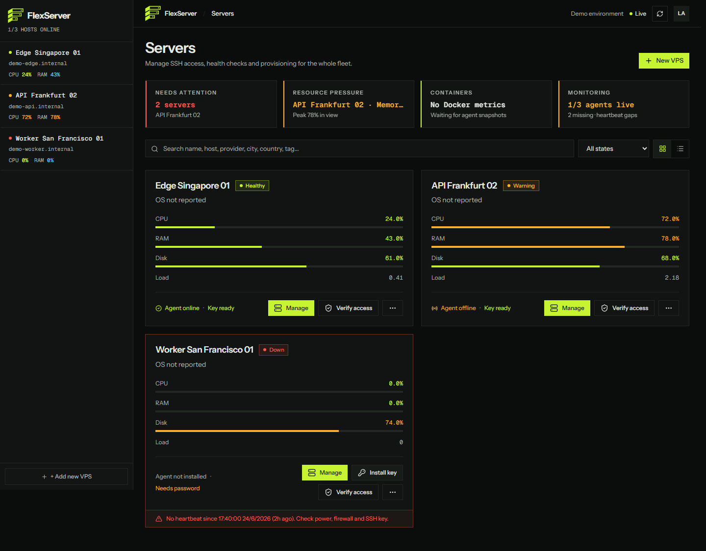
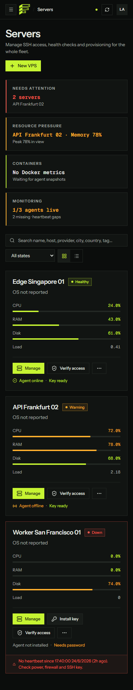

<p align="center">
  
</p>
<h1 align="center">FlexServer</h1>
<p align="center"><strong>by FlexTechnology</strong></p>
<p align="center">Your VPS fleet. One operational workspace.</p>
<p align="center">
  Self-hosted server monitoring and management with a NestJS API,<br>
  a React dashboard, and an optional Go host agent.
</p>
<p align="center">
  <a href="#capabilities">Capabilities</a> ·
  <a href="#screenshots">Screenshots</a> ·
  <a href="#quick-start">Quick start</a> ·
  <a href="#deployment-and-documentation">Documentation</a> ·
  <a href="#operational-boundaries">Security</a>
</p>

---

## A clearer view of your infrastructure

FlexServer brings server health, resource history, SSH workflows, jobs, and audit activity into one self-hosted dashboard. Start with simulated infrastructure to explore the interface, then configure a separate local-mode deployment for real hosts.

**You run the application and control its storage and access.** Demo data is not live telemetry, and switching modes does not turn simulated records into real servers.

## Capabilities

| Workspace | What it provides |
| --- | --- |
| **Fleet overview** | VPS inventory and health summaries, with a focused workspace for each host. |
| **Host metrics** | CPU, memory, disk, load, network throughput, and uptime; retained per-host CPU/RAM histories and availability-aware network charts. |
| **SSH operations** | Key provisioning and verification, command jobs, and audit activity. Real connections require local mode, allowed targets, and trusted host keys. |
| **AI VPS Assistant** | Bring-your-own provider (endpoint, model, API key). Per-host conversations render assistant responses as formatted Markdown — headings, tables, and code — inside the chat. Observation is read-only over cached metrics and inventory; proposed Docker/Compose actions run only after you approve the exact plan. Shell execution and provider egress of logs or files stay off unless explicitly enabled per host, and `APP_AI_ENABLED=false` disables the subsystem. Host execution additionally requires the separately installed Linux AI runtime. |
| **Docker visibility** | Agent-backed container monitoring. Read-only container logs are available by default for non-system VPS records in local mode, with a compatible real agent and Docker access. |
| **Docker Compose applications (phase 2)** | Read-only project discovery and capability status. Lifecycle/deployment mutations are unavailable until the agent reports a verified compatible Compose runtime; management is a separate per-VPS opt-in, and any runtime preparation is explicit. |
| **Deployment choices** | Run from source, use Docker Compose with PostgreSQL, or deploy with the Linux amd64 installer. An optional Go agent collects host metrics and supports safe local updates using bundled binaries. |

The web terminal is optional and disabled by default. Demo mode shows canned output only; it never opens a real SSH connection.

## Screenshots

Current **Servers** workspace, captured with Playwright/Chromium from an isolated `APP_MODE=demo` instance at 1440px desktop and 390px mobile widths. All three hosts and their metrics are simulated; these images do not show live infrastructure. Run the [demo](#explore-without-a-vps) to explore the interface.

[](docs/screenshots/overview.png)

<details>
<summary>Mobile screenshot</summary>

<a href="docs/screenshots/mobile.png"></a>

</details>

## Quick start

### Explore without a VPS

Use **Node.js 22**, npm, and Git. Run these commands from the repository root:

```bash
git clone https://github.com/ArseneLupin0111/FlexServer.git
cd FlexServer
npm ci
npm run build
npm start
```

The default is `APP_MODE=demo`. If using an existing configuration, set `APP_MODE=demo` and keep `ENABLE_WEB_TERMINAL=false` in `.env` before starting.

- Open the deployed demo dashboard at <http://localhost:3000/vps>; no real VPS, SSH credentials, or dashboard password are required in demo mode.
- <http://localhost:3000> is the FlexServer homepage, **not a public demo or dashboard-entry shortcut**.
- Check API health at <http://localhost:3000/api/health>.

Demo mode simulates servers, metrics, jobs, audit events, and terminal output. Real SSH is disabled. Docker monitoring needs real agent snapshots and permissions; read-only container logs are not available in demo mode.

For development, run `npm run dev` and `npm run dev:web` in separate terminals. See the [demo guide](docs/demo.md) and [environment reference](.env.example).

### Connect real infrastructure

Follow the [local-mode setup](#run-in-local-mode) to configure `APP_MODE=local`, generate a session secret of at least 32 characters, and set the dashboard administrator password. Keep the terminal disabled initially. Add real VPS records, establish SSH host-key trust, and configure agents as needed.

Use separate storage for demo exploration and real infrastructure. Read the [security model](docs/security.md) before enabling remote access or granting an agent Docker permissions.

## Browser integration tests

Use Node.js 22 and run from the repository root:

```bash
npm ci
npx playwright install chromium
npm run test:e2e
npm run test:e2e -- --repeat-each=2
npm run test:e2e:headed -- --grep "persists and revokes session"
npm run test:e2e -- e2e/vps.spec.ts
```

On Linux, install browser system dependencies with `npx playwright install --with-deps chromium` instead. Each E2E command builds the React UI and NestJS API first. Chromium journeys verify the login gate, invalid passwords, session persistence across reload, logout, server-side rejection of a revoked cookie, and creation of a VPS through the UI with connection details preserved in the API and fleet list after reload.

The fixture starts a real loopback NestJS server on a dynamic port with temporary JSON storage and generated credentials, then closes it and removes its data. It does not read `.env` or reuse a running server. VPS creation uses a documentation-only IP and leaves the optional provisioning password blank: it creates a real inventory record, without SSH key installation, agent installation, or remote connectivity checks. The local agent and web terminal remain disabled. PostgreSQL, reverse proxies, and other browsers are outside this suite. `npm test` remains the separate Vitest runner.

Open the local HTML report with `npx playwright show-report`. Reports and failure traces/screenshots are ignored by Git; traces can contain the disposable test credentials. CI runs E2E on every existing workflow event and requires both `verify` and `e2e` before deployment. See [CI/CD](docs/ci-cd.md).

## Run in local mode

Prerequisites: Node.js 22, npm, Git, and an OpenSSH client (`ssh-keyscan` is needed for host-key discovery). The commands below use Bash; on Windows, use Git Bash or equivalent PowerShell commands. Run from a fresh checkout, not a demo deployment:

```bash
git clone https://github.com/ArseneLupin0111/FlexServer.git
cd FlexServer
npm ci
cp .env.example .env
node -e "console.log(require('node:crypto').randomBytes(32).toString('hex'))"
```

Edit `.env` before running the password CLI or server. Paste the generated secret (not the command) into `DASHBOARD_SESSION_SECRET`:

```dotenv
APP_MODE=local
STORAGE_DRIVER=json
DATA_DIR=data-local
PRIVATE_DIR=private-local
DASHBOARD_SESSION_SECRET=<paste-generated-64-character-hex-secret>
DASHBOARD_PUBLIC_ORIGIN=http://localhost:3000
DASHBOARD_COOKIE_SECURE=false
ENABLE_WEB_TERMINAL=false
```

Replace existing assignments rather than adding conflicting duplicates. Keep `.env` private. The HTTP origin and non-secure cookie above are for loopback access only. For a remote VPS, use an SSH tunnel (`ssh -L 3000:127.0.0.1:3000 user@host`) and firewall the application port, or configure HTTPS before exposing it.

Build and bootstrap the administrator password using the **same `.env` and storage** as the server:

```bash
npm run build
read -r -s -p 'Dashboard password (8–256 characters): ' DASHBOARD_PASSWORD; printf '\n'
printf '%s\n' "$DASHBOARD_PASSWORD" | npm run set-dashboard-password:prod -- --stdin
unset DASHBOARD_PASSWORD
npm start
```

Open <http://localhost:3000/vps> and log in with that password (no username). Check <http://localhost:3000/api/health>. The homepage at `/` is public, not a login bypass. There is no default local-mode password; running the password CLI again rotates it and revokes existing sessions. Do not put passwords in command-line arguments or commit them.

`data-local/` holds JSON state, credentials, and sessions; `private-local/` holds private assets. Back up both with restricted access. Never reuse demo directories or a demo database for real infrastructure: mode changes do not convert simulated records. For development, the password can instead be set with `npm run set-dashboard-password -- --stdin`; run `npm run dev` and `npm run dev:web` in separate terminals.

### Trust and connect real hosts

Before provisioning managed SSH keys, initialize an external encryption keyring:

```bash
npm run manage-ssh-keys -- init --path /absolute/path/outside-checkout/ssh-keyring.json
```

Choose a writable path outside the checkout, `DATA_DIR`, and `PRIVATE_DIR`; set `SSH_KEY_ENCRYPTION_KEY_FILE` to it in `.env` and restart. Restrict access to the application account (POSIX `0600`, or owner-only NTFS ACLs); keep a separate offline recovery copy. Missing keyrings fail SSH operations closed. See [key management](docs/security.md#ssh-private-key-envelope-encryption--management).

Add a real VPS in the dashboard. Independently verify its SSH host-key fingerprint through a trusted provider console before accepting/pinning it; keep `SSH_HOST_KEY_POLICY=strict`. Pins can be configured with `SSH_HOST_KEY_PINS` keyed by VPS ID or `host:port`. Private-network destinations require explicit `ALLOW_PRIVATE_NETWORK_TARGETS=true`; metadata/link-local targets remain blocked. Configure agents only after access and trust are established; see the [operator runbook](docs/local-agent-upgrade-operations.md). Keep the terminal disabled until its HTTPS/origin and host transport prerequisites in the [security model](docs/security.md) are satisfied.

## Deploy with Docker Compose

Prerequisites: Git, Docker Engine with a running Linux-container daemon, Docker Compose v2, and network access to build base images. Use a fresh checkout of the [canonical repository](https://github.com/ArseneLupin0111/FlexServer), then run from its root:

```bash
cp .env.example .env
node -e "console.log(require('node:crypto').randomBytes(32).toString('hex'))"
```

Node is only used here to generate secrets; without Node, use `openssl rand -hex 32`. Generate two independent secrets. Edit `.env` with `APP_MODE=local`, `ENABLE_WEB_TERMINAL=false`, `DASHBOARD_SESSION_SECRET=<first-generated-secret>`, and `POSTGRES_PASSWORD=<second-generated-hex-secret>`. A hex database password is safe in the Compose connection URL; arbitrary reserved URL characters require encoding. For loopback testing set `DASHBOARD_PUBLIC_ORIGIN=http://localhost:3000` and `DASHBOARD_COOKIE_SECURE=false`.

```bash
docker compose config --quiet
docker compose up -d --build
docker compose ps -a
docker compose logs migrate
read -r -s -p 'Dashboard password (8–256 characters): ' DASHBOARD_PASSWORD; printf '\n'
printf '%s\n' "$DASHBOARD_PASSWORD" | docker compose exec -T api node dist/scripts/set-dashboard-password.js --stdin
unset DASHBOARD_PASSWORD
```

Compose waits for PostgreSQL health, runs migrations to completion, then starts API and web. If startup fails, inspect `docker compose logs api postgres migrate` before bootstrapping. Open <http://localhost:3000/vps> and log in; health is at <http://localhost:3000/api/health>. The API's direct port is loopback-only at `127.0.0.1:3001`; the web port `3000` is published on all interfaces. Firewall it or bind it to loopback before testing remotely. For internet access, put web behind an HTTPS reverse proxy, set the exact `DASHBOARD_PUBLIC_ORIGIN=https://your-host`, `DASHBOARD_COOKIE_SECURE=true`, and `TRUST_PROXY_HOPS` to the actual trusted proxy count (including the Compose nginx hop). Recreate API after changing `.env`: `docker compose up -d api`.

The root Compose stack uses PostgreSQL, not source-mode JSON: `vps-manager-postgres` stores the database, `vps-manager-data` stores application data, and `vps-manager-private` stores private assets. Back up all three consistently. `docker compose down` preserves these named volumes; **`docker compose down -v` destroys them**. Use separate Compose project names (`docker compose -p flexserver-local ...` consistently on every command) for demo and local deployments so volumes cannot be shared accidentally. Changing `POSTGRES_PASSWORD` in `.env` does not rotate an already initialized database password.

For managed SSH keys, the encryption keyring must also be mounted read-only at an external path outside `/app`, `/app/data`, and `/app/private`, and `SSH_KEY_ENCRYPTION_KEY_FILE` must be passed explicitly to the API via a Compose override. The root Compose file does not do this automatically; follow the [keyring security requirements](docs/security.md#external-kek-keyring--storage-isolation). Never mount the Docker engine socket into the API.

## Install on a Linux amd64 VPS

The installer supports **Linux x86_64/amd64 only**, not ARM, macOS, or Windows. Use root/sudo, Bash, Git, curl, Python 3 (for `flexserverctl`), Docker Engine and its Compose v2 plugin. The optional host agent requires systemd. Install Docker from your distribution's supported instructions first; `--install-docker` instead runs the external get.docker.com script and should be reviewed separately.

Clone the canonical repository as above. Review [install.sh](scripts/install/install.sh), its sibling [library](scripts/install/installer-lib.sh), and [CLI](scripts/install/flexserverctl.py) before granting root access. Build explicit local images to avoid depending on the installer's historical registry defaults:

```bash
docker build --target api-runtime -t flexserver-api:local .
docker build --target web-runtime -t flexserver-web:local .
sudo bash scripts/install/install.sh --dry-run --skip-pull --skip-agent \
  --api-image flexserver-api:local --web-image flexserver-web:local
sudo bash scripts/install/install.sh --skip-pull --skip-agent \
  --api-image flexserver-api:local --web-image flexserver-web:local
```

Run interactively to enter a dashboard password. On a fresh install, an empty response or non-interactive run generates a password displayed by the installer; save it privately. Automation can supply a protected one-line file with `--dashboard-password-file /secure/path/password.txt`. Existing credentials are kept when no replacement is supplied. `--skip-agent` starts with the app only; omit it to install the host systemd agent after reviewing its permissions. Docker metrics access is a separate root-equivalent opt-in, not granted by default.

By default this installs JSON-backed local mode under `/opt/vps-manager`, generates a session secret, preserves it on reruns, and bootstraps the password. It is **not** the root PostgreSQL Compose stack. Keep `/opt/vps-manager/.env`, `data/`, and `private/` private and backed up. The web port defaults to `38280` (all interfaces); the API port `38281` is loopback-only. Firewall web before installation; access through `ssh -L 38280:127.0.0.1:38280 user@host`, then open <http://localhost:38280/vps>. For public access, configure HTTPS and cookie/origin/proxy settings in `/opt/vps-manager/.env` and recreate containers using its generated Compose file. Check `sudo docker compose -f /opt/vps-manager/docker-compose.yml ps` and the `/api/health` endpoint. Review the [runbook](docs/local-agent-upgrade-operations.md) for agent operations, backend cutovers, and `flexserverctl`.

## Deployment and documentation

| Start here | Reference |
| --- | --- |
| **Source installation and configuration** | [Local-mode setup](#run-in-local-mode) · [Environment variables](.env.example) |
| **Docker Compose** | [Deployment instructions](#deploy-with-docker-compose) — PostgreSQL, migrations, and persistent volumes |
| **Linux amd64 installation** | [Installer instructions](#install-on-a-linux-amd64-vps) — review the script before running it with `sudo` |
| **Architecture and data flow** | [Architecture](docs/architecture.md) |
| **Storage** | [PostgreSQL and TimescaleDB guide](docs/postgres-timescale-storage.md) |
| **Safe exploration** | [Demo guide](docs/demo.md) |
| **Access and host permissions** | [Security model](docs/security.md) |
| **Agent upgrades & deployment convergence** | [Operator runbook](docs/local-agent-upgrade-operations.md) — automatic deployment convergence, bundled agent updates, updater protocol v3, and safe rollback |
| **Project history** | [Changelog](CHANGELOG.md) |

The API, web interface, and agent live in `packages/api/`, `packages/web/`, and `packages/agent/`. Direct source runs use JSON storage by default; Docker Compose uses PostgreSQL. Local data and private keys are not served as public assets.

## Operational boundaries

- **Authentication is not optional for real infrastructure.** Local mode requires the administrator password and an HttpOnly session cookie. The public homepage does not bypass that gate.
- **Use HTTPS for public deployments.** Do not expose the local-mode dashboard over plain HTTP. Configure the public origin and secure-cookie settings for your deployment.
- **SSH is policy-gated.** Demo blocks real SSH. Local connections require an allowed target and trusted host key; private-network targets need explicit configuration.
- **Docker access is privileged.** The host agent has no Docker access by default. Opting into Docker group membership is effectively root-equivalent on the host. The API does not open the Docker socket.
- **Logs are read-only and ephemeral.** Local-mode streams need real agent capability, current container inventory, and Docker access. They do not enable container mutations and are not persisted to jobs, audit, or storage. System VPS records and demo mode are excluded.
- **Treat volumes and secrets as operational assets.** `docker compose down` preserves volumes; `docker compose down -v` deletes the data. Never commit `.env`, passwords, SSH keys, or tokens.
- **Automatic deployment convergence and scoped pull updates.** Managed agent installations (local and remote) automatically converge to the API deployment's bundled binaries without manual release selection or updater enrollment. The pull-only host updater runs as an unprivileged user, connects over HTTPS with scoped credentials, verifies SHA-256 digests and content build IDs, and uses a constrained root helper for atomic swaps and fresh-heartbeat verification with safe rollback. Repoint existing agents with `flexserverctl set-backend <URL>`. See the [runbook](docs/local-agent-upgrade-operations.md).
- **Agent singleton lock and managed service lifecycle.** Agents enforce a per-VPS singleton OS process lock in `/run/vps-manager-agent/` to prevent duplicate metric collectors and concurrent worker contention. Remote agents on Linux hosts run as managed systemd services with offline preflight validation (`-validate-config`) and automatic failure recovery.

See the [security model](docs/security.md) for the full configuration boundaries. Do not post vulnerability details or credentials in public issues; follow the [private reporting guidance](#reporting-security-issues).

## Support and license status

Report bugs and suggest features through [GitHub Issues](https://github.com/ArseneLupin0111/FlexServer/issues). For contribution requirements, see [Contributing and support](#contributing-and-support).

> **License status:** This repository does not currently contain a `LICENSE` file. No license to use, modify, or distribute the source code has been granted. Contact the maintainer before using it beyond the permissions provided by GitHub's terms.

## Reporting security issues

Use GitHub's enabled [private vulnerability reporting form](https://github.com/ArseneLupin0111/FlexServer/security/advisories/new) (sign-in required). Include the affected revision, configuration with secrets removed, impact, and minimal reproduction. Do not open a public issue or attach live credentials, private keys, tokens, or unredacted host data. Coordinate disclosure privately with the maintainer through that report.

## Contributing and support

Use the [canonical repository](https://github.com/ArseneLupin0111/FlexServer) and [Issues](https://github.com/ArseneLupin0111/FlexServer/issues) for non-security bugs and proposals; search existing reports first. Include the revision, OS/runtime versions, deployment method, reproduction steps, expected/actual results, and redacted logs. Discuss substantial changes before sending a focused pull request. No support SLA is promised; the license restriction above still applies.

Before submitting changes, run `npm test`, `npm run typecheck`, and `npm run build`. Run `npm run check:docs` for README repository-local paths and heading anchors; external URLs are not fetched. Additional Markdown files can be checked explicitly with `npm run check:docs -- docs/security.md`. Agent changes also require `npm run test:agent` with the Go version declared in [go.mod](packages/agent/go.mod).

<p align="center"><strong>FlexServer</strong> · by FlexTechnology</p>
