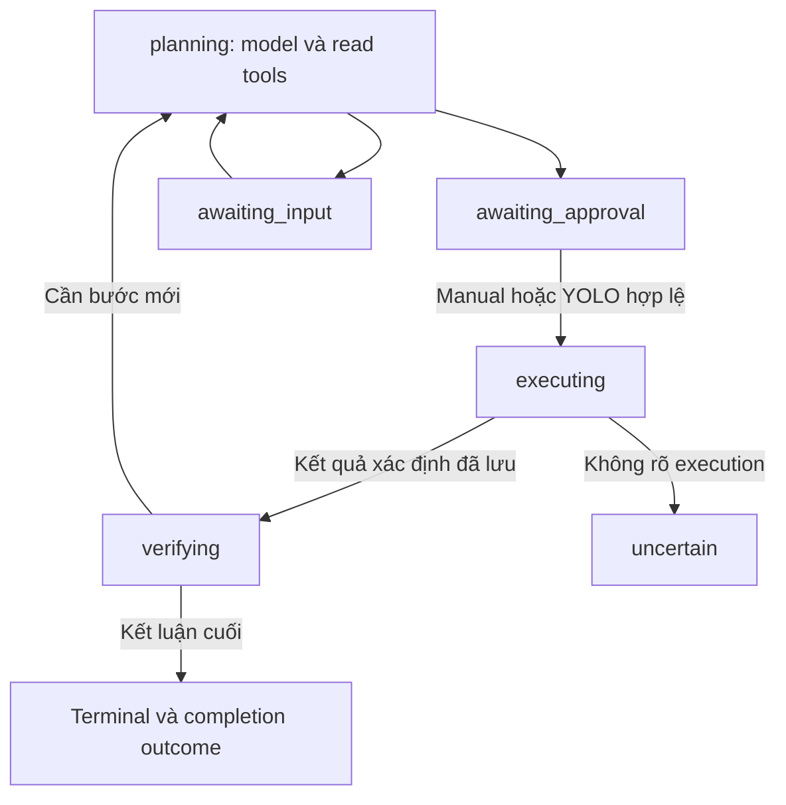

# Kế hoạch triển khai vòng lặp AI Agent bền vững

Trạng thái: runtime durable loop đã triển khai; host runtime proof đã hoàn tất qua authorized disposable-host smoke, còn real-provider workflow vẫn đang chờ vì chưa có credentials. Clean acceptance artifact xác nhận web suite 290 tests, desktop/mobile fixture actions, API loop acceptance final 166 passing/0 failed/0 pending trên 12 files, security coverage, PostgreSQL loop 12 passing, PostgreSQL migration 037 proof, web typecheck, và regression scheduler (recovery của `continuationReady`, single-flight `onModuleInit` đồng thời, provider exactly-once, task hoàn tất không cần manual wake). Host smoke: manual task `b746e91c-f270-4c8b-925a-5e9d823df411` dùng exact approvals v1/v2, restart unhealthy `500` không được verified, repair fresh `200` được verified, API SIGKILL/restart giữ durable plan/receipts không replay; YOLO task `a2a29902-c62b-4916-b27d-41f3af97c443` chạy hai plans auto-approved và markers UID 0 trên host thật thành công. Đây là scripted-orchestration proof, không phải real-provider run; các kết quả này không chứng minh real-provider readiness.

## 1. Mục tiêu và quyết định đã chốt

Một yêu cầu tự nhiên tạo một task có nhiều vòng: quan sát → suy luận → đề xuất → duyệt → thực thi → nhận kết quả → kiểm chứng → tiếp tục hoặc kết thúc. Không kết thúc toàn task chỉ vì một command thành công. Tiến trình không phụ thuộc tab trình duyệt hoặc callback trong RAM.

Hai chế độ:

| Hợp đồng | Manual | YOLO toàn quyền |
| --- | --- | --- |
| Quyền thao tác | Policy/scopes hiện hành | Toàn quyền quản trị VPS đang chọn, gồm shell privileged/root |
| Duyệt mutation | Từng plan/version/digest | Tự duyệt từng plan qua cùng đường authorization |
| Thao tác phá hủy | Theo quyền và plan được duyệt | Được phép nếu thuộc mục tiêu được giao; không hỏi thêm từng bước |
| Phạm vi | VPS cố định của task | VPS cố định của task; không mở quyền dashboard hoặc chuyển target |
| Gửi dữ liệu cho provider | Theo quyền egress files/logs riêng | Vẫn theo quyền egress files/logs riêng |
| Tiếp tục | Tự điều tra; chờ duyệt mutation kế tiếp | Tự điều tra, thực thi và kiểm chứng đến kết luận cuối cùng |

YOLO không có nghĩa mở rộng mục tiêu vô hạn, bỏ audit, bỏ chống replay, tự retry mutation mơ hồ hoặc vô hiệu Cancel/budget. Quyền root có thể phá hủy dữ liệu hoặc làm mất quyền truy cập host. Không thể dùng prompt để bảo đảm shell root không đọc secrets hoặc sửa chính thành phần agent trên host.

Không tự nâng cấu hình `autoApprove: true` cũ thành YOLO toàn quyền. Operator phải bật rõ chế độ mới với cảnh báo quyền root. Tính năng auto-approve giới hạn quyền cũ được thay thế bằng hợp đồng mới, không giữ hai ý nghĩa dưới cùng một toggle.

## 2. Phạm vi và phần không làm

Trong phạm vi:

- Nhiều vòng đọc và mutation trong cùng task, có lịch sử plan và kết quả bền vững.
- Host agent và Docker/Compose bridge cùng một hợp đồng completion/continuation.
- Manual approval từng plan và YOLO toàn quyền.
- Recovery, cancellation, session/policy/provider changes, budget và kiểm chứng mục tiêu.
- API, persistence JSON/PostgreSQL, Go authorization nơi liên quan, UI, tests và tài liệu.

Không làm:

- Sao chép framework Hermes, memory, skills, subagents hoặc worker orchestration tổng quát.
- Native Git credentials, build job dài, arbitrary-repo managed deployment.
- Tăng hoặc né timeout shell 120 giây bằng command nền không được quản lý.
- Rollback tự động hoặc cam kết exactly-once đối với mọi side effect bên ngoài.
- Bảo đảm thành công bằng mọi giá.

Nếu yêu cầu cần khả năng chưa có, agent phải kết luận blocker cụ thể. Vòng lặp không tự tạo khả năng chạy job dài.

## 3. Điểm xuất phát và tham chiếu

Các vị trí đã được khảo sát trong phiên lập kế hoạch; khi triển khai phải đọc lại symbol/callers hiện hành, không dựa vào số dòng cũ:

- `packages/api/src/ai/ai-task.service.ts`: provider/read loop, prompt/context, tạo plan, approve/auto-approve, bridge execution, cancel.
- `packages/api/src/ai/ai-agent.service.ts`: host result/receipt và transition sau execution.
- `packages/api/src/ai/ai.models.ts`: task, policy, plan và trạng thái.
- `packages/api/src/persistence/repositories/ai.repository.ts`: JSON/PostgreSQL, CAS, approval, outbox, receipts.
- `packages/api/src/ai/ai-read-tools.service.ts`: read observations và quyền gửi files/logs.
- `packages/api/src/ai/ai-host-plan.service.ts`, `ai-docker-bridge.service.ts`: plan/tool execution.
- `packages/api/src/ai/ai-retention.service.ts`: lifecycle, lease/session reconciliation, retention.
- `packages/api/db/migrations/030_ai_assistant.sql`, `036_ai_tasks_active_vps_idx.sql`: schema và active-slot invariant hiện có. Không đoán số migration tiếp theo.
- `packages/web/src/components/dashboard/assistant/`: task inspector, approvals, chat, permissions và tiến trình.
- `packages/agent/`: kiểm tra các policy/capability gate, command validation và receipt journal liên quan trước khi đổi YOLO.

Hermes tham chiếu: `hermes-agent/agent/conversation_loop.py`, `tool_executor.py`, `verification_stop.py`, `verification_evidence.py`, `turn_loop_errors.py`. Lấy feedback loop, tool-result pairing và verify-on-stop; không lấy vòng lặp RAM làm cơ chế recovery của VPS.

## 4. Invariants bắt buộc

1. Một mutation đang hoạt động trên một VPS; giữ active-slot và unresolved-outcome fence hiện có.
2. Mọi side effect có command identity ổn định, gắn task/plan version/step/digest trước dispatch.
3. Mọi plan mới có version tăng đơn điệu, ID/digest mới và approval riêng. Approval cũ không thể duyệt plan mới.
4. Không phát lại mutation vì provider timeout, mất callback, hết lease hoặc restart API.
5. Receipt trùng không tạo observation/continuation trùng; receipt cũ không kết thúc plan mới.
6. `uncertain` không tự chuyển thành thất bại xác định chỉ để tiếp tục mutation.
7. Policy/session/target/precondition kiểm tra ở thời điểm admission và sát dispatch, không chỉ trong prompt.
8. Không đánh dấu task hoàn tất trước khi outcome và bằng chứng cuối được commit.
9. Provider output, repo, logs, tool results và checkpoint là dữ liệu không đáng tin, không phải authorization.
10. Counter và deadline tính toàn task, không reset khi resume/restart.
11. Cancel không xóa receipt hoặc giả định rollback đã xảy ra.

## 5. Hợp đồng trạng thái và kết luận

Tái sử dụng trạng thái hoạt động hiện có, không thêm state cho từng loại tool:

`verifying` nghĩa là xử lý execution observation và xác minh mục tiêu, không chỉ kiểm tra chữ ký receipt. Các lượt model trong trạng thái này dùng cùng lease/budget/cancellation rules như planning.

Thêm completion outcome có cấu trúc, tách khỏi execution outcome:

| Completion outcome | Task state | Ý nghĩa |
| --- | --- | --- |
| `verified` | `succeeded` | Đủ bằng chứng đúng target/mục tiêu |
| `unverified` | `failed` | Execution xác định nhưng không thể xác minh mục tiêu; UI không trình bày là command thất bại |
| `blocked` | `failed` | Blocker xác định, không tiến triển hoặc hết budget |
| `cancelled` | `cancelled` | Đã dừng continuation; liệt kê phần đã thực thi |
| `expired` | `expired` | Session/deadline hết hiệu lực theo hợp đồng |
| Chưa có completion | `uncertain` | Execution chưa rõ; giữ fence và đối soát |

Dùng error/reason code có kiểu để phân biệt budget, capability, verification unavailable, session, provider và command errors; không yêu cầu UI suy ra từ prose. Lỗi một step không đồng nghĩa task lập tức failed: nếu xác định và còn khả năng sửa trong phạm vi, chuyển observation cho model.

## 6. Persistence và transaction contract

### 6.1 Dữ liệu cần lưu

Mở rộng domain/repository bằng cấu trúc có kiểu; không nhét vào metadata tùy ý:

- Phiên bản hợp đồng thực thi của task: legacy one-shot hoặc durable loop.
- Execution mode: manual hoặc full YOLO; policy revision được chấp nhận.
- Lượt đang chạy: sequence, phase, lease owner/token, expiry và trạng thái chờ tiếp tục.
- Các bộ đếm tích lũy: provider calls, read calls, mutation plans, token usage, verification attempts; deadline tuyệt đối.
- Plan history bất biến về identity/payload digest; trạng thái plan thay đổi qua transition được kiểm soát.
- Tool call/result journal: identity, tool name, execution references, restricted-source classification, observation đã xử lý.
- Completion outcome, reason, evidence references.

Tái sử dụng encrypted payload/blob và repository patterns hiện có. Không lưu credentials hoặc raw script/file/log ngoài quy tắc hiện hành. Raw streams vẫn ephemeral; durable evidence chỉ là nội dung được phép, bounded/redacted và references/digests.

Thiết kế storage cụ thể sau khi kiểm tra projection giữa state journal và relational tables. Migration phải cập nhật cả representation thực sự được dùng; JSON adapter phải có normalization/migration tương đương. Không coi JSONB là lý do bỏ versioning hoặc invariant.

### 6.2 Các thao tác nguyên tử

Repository cung cấp số ít thao tác theo invariant, tên cụ thể chốt lúc triển khai:

- Claim/renew model turn bằng CAS và lease token; worker cũ không được commit sau khi mất lease.
- Commit model turn: tool calls/usage/plan hoặc completion cùng expected revision.
- Approve và consume đúng plan version/digest, đồng thời tạo execution intent/outbox.
- Record execution observation một lần, đồng thời đánh dấu continuation-ready khi đủ kết quả của plan.
- Cancel/invalidate task và chặn dispatch/continuation mới.

Không giả định mọi thứ phải nằm trong một hàm transaction lớn. Side effect bên ngoài transaction cần execution intent và đối soát; không dùng DB transaction để che cửa sổ crash.

## 7. Tool-result và quyền egress

Chuẩn hóa host/bridge observation gồm command/tool-call identity, target, timestamps, status, exit code nếu có, bounded evidence và provenance.

Wire context phải giữ đúng assistant tool call + tool result; không lưu tool result mồ côi hoặc tóm tắt thành câu giả như “đã thành công” khi chưa có bằng chứng. Mỗi tool call có tối đa một kết quả hiệu lực. Lỗi provider protocol cũng phải đóng cặp hợp lệ mà không bịa execution outcome.

Quyền thực thi root khác quyền gửi dữ liệu:

- Files/logs và nội dung shell chứa dữ liệu tương đương không được tự vượt quyền egress.
- Đánh giá đường shell output/error, bridge output và compaction, không chỉ named file/log tools.
- Với tool có thể trả dữ liệu nhạy cảm mà không chứng minh an toàn, không gửi raw output; dùng status metadata và evidence đã được phép, hoặc báo thiếu khả năng xác minh.
- Revalidate quyền trước provider dispatch và khi replay history/checkpoint.
- Không in token/private key hoặc đưa credentials vào câu lệnh hiển thị/chat.

Redaction là phòng vệ bổ sung, không phải chứng minh không rò secrets. Không cho model tự gắn nhãn output là an toàn để vượt chặn backend.

## 8. Điều phối và recovery

Chỉ một nơi điều phối model turns trong module AI. Host receipt và bridge completion đều ghi observation qua cùng repository contract, không trực tiếp gọi vòng suy luận lẫn nhau.

Event sau commit chỉ đánh thức nhanh. Reconciler tìm continuation-ready từ storage và claim lượt, nên mất event không mất task. Tránh dependency vòng `AiAgentService` ↔ `AiTaskService`; không thêm generic event bus nếu cơ chế hiện có đủ dùng.

| Điểm crash | Hành vi recovery |
| --- | --- |
| Trong model call, chưa commit plan | Có thể gọi lại suy luận theo budget/lease; chưa có side effect |
| Plan đã commit, chưa duyệt | Giữ plan, chờ manual hoặc auto-approve hợp lệ |
| Approval/intent đã commit, chưa dispatch | Claim intent theo outbox hiện có; kiểm tra invalidation/cancel |
| Command đã dispatch, chưa có receipt | Đối soát command journal/receipt; không phát lại mutation mù |
| Receipt đã ghi, chưa tạo observation | Reconciliation tạo observation idempotently |
| Observation đã ghi, mất event | Reconciler claim continuation |
| Worker cũ trả kết quả sau mất lease | Không được commit model decision mới |
| Bridge side effect xong nhưng chưa lưu outcome | Đối soát theo khả năng thực tế; không chứng minh được thì uncertain |

Không hứa exactly-once tổng quát. Mục tiêu là không chủ động replay mutation mơ hồ và giữ được bằng chứng để đối soát.

## 9. Kiểm chứng, sửa lỗi và runaway

Sau mutation, agent dùng bằng chứng phù hợp mục tiêu: service status, container health, đọc lại cấu hình hoặc kiểm tra chức năng. Bằng chứng phải có target/time và liên quan postcondition; không dùng kết quả cũ trước mutation để xác minh.

Nếu execution result đã chứa đủ bằng chứng thì không ép thêm tool call. Nếu chưa đủ, backend chặn kết luận verified không có evidence references và yêu cầu kiểm chứng lại hữu hạn. Model có trách nhiệm đánh giá ý nghĩa mục tiêu; backend kiểm tra cấu trúc/provenance/freshness, không giả định có oracle chứng minh mọi yêu cầu tự nhiên.

Lỗi xác định → quan sát thêm hoặc plan sửa mới. Manual duyệt lại; full YOLO tự duyệt. Lỗi không xác định → chỉ đối soát đọc an toàn, không mutation bù.

Dùng budget/token/deadline hiện có nếu phù hợp; bổ sung counter còn thiếu. Các trần hữu hạn cho toàn task; không thêm tùy chọn cấu hình cho từng tool nếu không cần. Chốt giá trị mặc định dựa trên workflow nghiệm thu, không chốt số tùy ý trong plan này. Mọi trần phải có kiểm thử tại ngưỡng.

Phát hiện no-progress bằng repeated tool/target/action cùng kết quả liên quan không đổi, không chỉ so chuỗi prose. Không cấm polling health hợp lệ: polling phải có giới hạn/deadline và phân biệt trạng thái đang thay đổi với vòng sửa lỗi lặp.

## 10. Cancel, session và thay đổi cấu hình

- Cancel command chưa dispatch bằng transition nguyên tử cạnh tranh với claim/dispatch.
- Command đã dispatch: yêu cầu stop nếu adapter hỗ trợ, tiếp tục nhận receipt; không khẳng định đã dừng trước bằng chứng.
- Không dispatch bước mới sau cancellation thắng CAS. Nếu dispatch thắng trước, hiển thị đúng phần đã chạy.
- Logout/expiry ngăn lượt tiếp và dispatch mới; receipt vẫn được ghi nhận để giữ accounting/fences.
- Đổi policy/provider dừng ở điểm an toàn và vô hiệu plan chưa dispatch. Resume rõ ràng từ người dùng, revalidate session/context/egress và lập lại plan; không reset budget.
- Đóng tab không hủy task nếu session còn hợp lệ.
- Retention không xóa plan/receipt/blob còn cần cho active/uncertain task; không xóa history từng bước giữa task.

## 11. YOLO toàn quyền: cutover authorization

Thay đổi không chỉ ở prompt hoặc `autoApprove`:

1. Thêm mode có nghĩa rõ vào domain, API validation và persistence.
2. Legacy policies giữ quyền giới hạn/manual cho đến khi người dùng bật full YOLO rõ ràng. Legacy task giữ one-shot contract, không tự resume thành loop.
3. Tính effective execution permissions tập trung từ mode và target; rà soát mọi gate API, read tools, plan admission, dispatch, Go worker/helper và bridge.
4. Không giả mạo bật từng permission egress để đạt execution full quyền; egress độc lập.
5. Command mang authorization snapshot/revision phù hợp cơ chế hiện hành; revalidate trước dispatch/claim theo đường thực thi.
6. Gỡ semantics auto-approve cũ, prompt/tool descriptions và caller obsolete sau khi migration xong. Không giữ shim runtime hoặc hai toggle đồng nghĩa.
7. Cập nhật capability/version negotiation nếu wire contract đổi; agent cũ không được nhận command mà nó diễn giải sai. Upgrade cần thiết phải là prerequisite rõ ràng, không fallback yếu hơn.

## 12. UI/API

Một task hiển thị timeline nhiều vòng, không biến mỗi plan thành task mới:

- Mục tiêu ban đầu, trạng thái hiện tại, step đang chạy và lịch sử plan.
- Approve/reject đúng plan version/digest; nút cũ không thao tác plan mới.
- Evidence/kết quả từng bước và kết luận cuối phân biệt verified/unverified/blocked/uncertain.
- Cancel với nghĩa chính xác; Resume cho cấu hình đã thay đổi.
- Reload/SSE reconnect dựng lại toàn bộ trạng thái từ durable API; SSE không phải nguồn chân lý duy nhất.
- YOLO full quyền có warning bền vững, bật rõ ràng, không tự kích hoạt cho policy cũ.
- Không hiện secrets trong preview, error, timeline hoặc export/audit.

Cập nhật API serializers, request/response schemas, web types và mọi caller liên quan trong cùng cutover.

## 13. Các giai đoạn thực hiện và tiêu chí qua

### Giai đoạn 1 — Domain và persistence

- Đọc lại callers/reference bằng LSP; xác định transaction seams hiện có.
- Implement loop-version, plan history, journal/counters, outcome và continuation ownership.
- Migration PostgreSQL, JSON normalization và legacy task/policy cutover.

Qua khi: JSON/PostgreSQL cùng hợp đồng; plan cũ không mất; duplicate observation/claim bị ngăn; approval cũ bị từ chối; migration chạy được với dữ liệu legacy đại diện.

### Giai đoạn 2 — Execution observations và egress

- Host receipt và bridge đi chung completion contract.
- Durable tool pairing, restricted-source propagation và bounded evidence.
- Crash gap reconciliation; bridge ambiguous outcome không terminal-success giả.

Qua khi: receipt trùng/trễ không duplicate; shell/file/log/provider history không vượt quyền; crash tại các commit gap phục hồi an toàn.

### Giai đoạn 3 — Durable continuation

- Thay direct terminal-success sau mutation bằng observation → verifying/continuation.
- Claim/lease/reconciler và session/cancel checks.
- Manual nhiều plan trước, rồi nối auto-approval qua cùng đường.

Qua khi: read → plan 1 → receipt → kiểm chứng → plan 2 → receipt → final trong một task; kill/restart không mất bước hoặc phát lại mutation.

### Giai đoạn 4 — Verify-on-stop và giới hạn

- Completion outcome có evidence/reason.
- Lỗi xác định được phản hồi model, uncertain chặn mutation.
- Budget/deadline/no-progress và cancel/resume giữ counter.

Qua khi: command success/app unhealthy không báo verified; thiếu quyền kiểm chứng trả unverified; loop lặp/hết budget dừng đúng; không retry mutation mơ hồ.

### Giai đoạn 5 — Full YOLO và UI/API cutover

- Effective authorization end-to-end, mode migration và cảnh báo.
- Timeline, per-plan approval, final outcomes, cancel/resume, durable reload.
- Cập nhật prompt theo runtime thực tế; loại bỏ chỉ dẫn one-shot obsolete.

Qua khi: operator bật full YOLO rõ ràng thì agent thực thi trong VPS cố định mà không hỏi duyệt từng plan; policy cũ không được nâng quyền; egress vẫn độc lập; desktop/mobile thể hiện đúng trạng thái.

### Giai đoạn 6 — Nghiệm thu tích hợp

- Contract tests, disposable-host runtime proof, crash/restart và real-provider workflow.
- Cập nhật architecture/security/operations/changelog theo hành vi đã chứng minh; bỏ smoke scaffolds.

Qua khi: ma trận dưới đây có evidence; không coi tests giả lập là chứng minh host hoặc LLM thật.

## 14. Ma trận nghiệm thu

| Nhóm | Kịch bản bắt buộc |
| --- | --- |
| Manual | Hai mutation cần hai approvals; replay approval cũ bị từ chối |
| YOLO | Hai mutation tự tiếp tục; privileged thực sự qua host path; target khác bị từ chối |
| Legacy | autoApprove cũ không thành full root; task cũ không tự sống lại |
| Goal verification | Restart exit 0 nhưng app unhealthy không verified; health sau sửa mới verified |
| Failure | Lỗi xác định được đưa lại model; blocker thật kết thúc đúng reason |
| Uncertain | Timeout/mất receipt sau dispatch không tự retry hoặc chạy lệnh bù |
| Recovery | Kill trước/sau plan commit, dispatch, receipt commit và continuation claim |
| Concurrency | Hai worker, lease cũ trả muộn, receipt trùng/trễ, heartbeat CAS conflict |
| Cancel | Race cancel/dispatch; command đã chạy vẫn được đối soát; không có bước sau |
| Security | Logout, policy/provider change, stale preimage, forged target/digest |
| Egress | Files/logs cấm gửi; shell output chứa dữ liệu nhạy cảm; checkpoint replay sau revoke |
| Budget | Các ngưỡng tích lũy; resume/restart không reset; polling hữu hạn không bị nhầm với no-progress |
| UI | Reload/reconnect, approval stale, timeline dài, final outcomes, desktop/mobile |
| Storage | Cùng scenarios hành vi trên JSON/PostgreSQL, migration và retention |

Permanent tests đi qua public/repository seams, kiểm tra invariants và hành vi người dùng; không kiểm tra prompt wording hoặc wiring/source text. Dùng provider có kịch bản cho orchestration tests, không gọi đó là chứng minh reasoning.

Runtime proof: **completed** on an authorized disposable host with a controllable app/service. Manual task `b746e91c-f270-4c8b-925a-5e9d823df411` required exact approvals v1/v2; restart produced health `500` and remained unverified until the repair produced a fresh `200`; API SIGKILL/restart preserved the durable task plan and receipts without replay. YOLO task `a2a29902-c62b-4916-b27d-41f3af97c443` executed two auto-approved plans and recorded successful actual-host UID 0 markers. This is a scripted-orchestration host proof boundary, not real-provider evidence; no logs or secrets are retained in this plan, and no deleted smoke harness is referenced.

Real-provider proof: ít nhất một workflow nhiều bước với LLM thật, evidence thật; ghi model, task/command IDs, outcomes và giới hạn quan sát, không ghi secrets. Nếu chưa có credentials/host được phép, báo đúng prerequisite, không thay bằng kết quả giả lập.

## 15. Definition of done

- Một yêu cầu chạy end-to-end nhiều vòng và kết thúc đúng hợp đồng.
- Mọi affected caller/model/schema/adapter/UI/test/docs được chuyển sang semantics mới.
- Recovery và uncertain fences được chứng minh bằng runtime crash scenarios.
- Full YOLO thực sự có execution quyền đã chốt; không vô tình mở egress hoặc nâng legacy config.
- Không còn terminal-success trực tiếp chỉ vì một mutation thành công trên loop-version tasks.
- Không còn vòng RAM duy nhất, callback-only resume, plan history overwrite hoặc retry mutation mơ hồ.
- Có bằng chứng smoke host thật, UI thật và real-provider; phần chưa kiểm chứng được nêu rõ, không tuyên bố hoàn tất thay thế.
