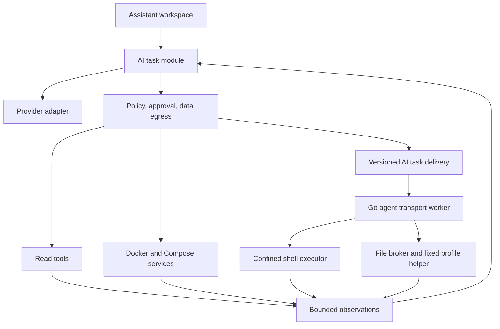
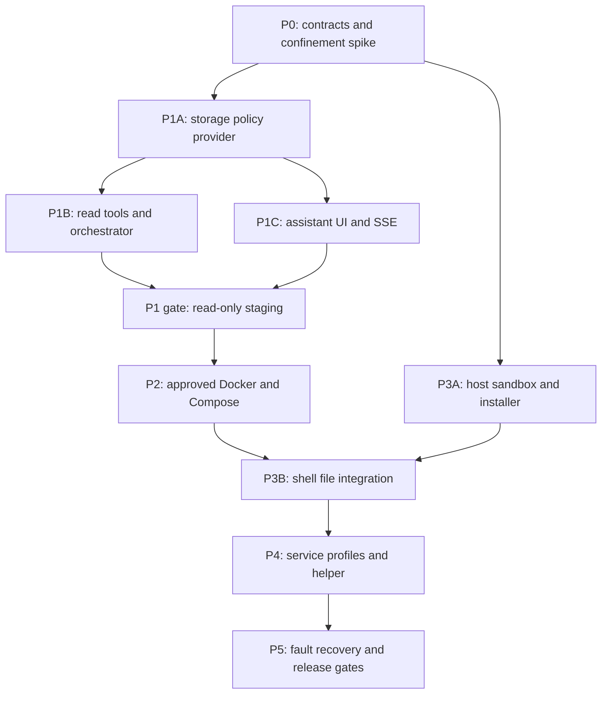

# Flexserver AI Assistant — Kế hoạch triển khai chi tiết

Ngày lập: 2026-10-21.

## 0. Trạng thái triển khai thực tế (2026-10-21, đối chiếu mã nguồn)

**Trạng thái tổng thể: Triển khai dở dang, chưa đủ điều kiện phát hành (production-ready) hoặc bật mutation.**

Mã nguồn hệ thống Flexserver AI Assistant đã được thiết lập đầy đủ về mặt cấu trúc và logic ở tất cả các tầng (API NestJS, Agent Go worker/executor/helper, Web UI, cơ sở dữ liệu và công cụ quản trị). Tài liệu này phân định nghiêm ngặt giữa các thành phần **Đã cài đặt mã nguồn (Implemented)** và các thành phần **Chưa được kiểm chứng thực tế (Unverified)**. Không tự ý coi tính năng là hoàn tất khi chưa có kiểm chứng độc lập từ bộ test runner/smoke tập trung của Parent.

### 0.1 Bảng ma trận hiện trạng chi tiết

| Khu vực / Thành phần | Mã nguồn / Files liên quan | Trạng thái | Phân định kiểm chứng & Ghi chú |
| --- | --- | --- | --- |
| **Provider Adapter** | `packages/api/src/ai/ai-provider.ts` | Implemented / Verified | **Đã kiểm chứng**: Vitest 21/21 tests pass (`ai-provider.test.ts`), bao gồm synthetic model check, SSE stream parser, bounds và chuẩn hóa lỗi `AiAssistantError`. (Tổng `ai-provider` + `ai-persistence` + `ai-docker-bridge` = 21 + 26 + 12 = **59 tests pass**.) |
| **JSON Persistence & Safety Lifecycle** | `packages/api/src/persistence/repositories/ai.repository.ts`, `packages/api/src/auth/dashboard-session.service.ts` | Implemented / Verified | **Đã kiểm chứng**: Vitest 26/26 tests pass (`ai-persistence.test.ts`), bao gồm key-order structural retry regression; smoke runtime cục bộ (`AiOperationsSafety`) xác nhận chuyển trạng thái khi thu hồi phiên (`session_revoked` / `cancel_requested`), xử lý worker lease quá hạn (`uncertain`), và bảo toàn retention sau 30 ngày prune (kiểm chứng runtime cục bộ, không phải mức OS). **Bridge approve**: CAS `approve` ghi `consumed` một lần với digest khớp, từ chối replay/lệch digest/sai phiên. |
| **PostgreSQL Persistence Adapter** | `packages/api/src/persistence/repositories/ai.repository.ts` | Implemented / Đã smoke | **Đã smoke**: PostgreSQL smoke test trên container độc lập (`postgres:16-alpine`) đạt 7/7 checks pass, xác nhận admission đồng thời, CAS approve race, claim/ack, receipt conflict semantics và exact retry sau đối soát JSONB key-order structural equality. Parity test suite trong CI đang hoàn thiện. |
| **Persistence Seam & Types** | `packages/api/src/persistence/repositories/ai.persistence.ts` | Implemented | Giao diện trừu tượng `AiRepository`, kiểu `StoredTask`, `StoredAiState` và hàm bao bọc `withAiAdminLock`. |
| **Database Migrations** | `packages/api/db/migrations/030_ai_assistant.sql`, `031_ai_state_journal.sql` | Implemented / Verified | Đầy đủ schema DDL theo §8.1 cho PostgreSQL (conversations, tasks, steps, commands, approvals, receipts, provider settings); tích hợp đầy đủ và tự động qua `loadMigrations`/`selectMigrations`/`runMigrations`, startup service Compose `migrate`, kiểm tra `/api/health`, và wiring vào `createRepositories`/`AppDependencies`. |
| **NestJS Wiring & Controllers** | `packages/api/src/app.module.ts`, `packages/api/src/ai/ai.controller.ts`, `ai-agent.controller.ts` | Implemented / Một phần đã kiểm chứng | Module wiring, dependency injection, token `AI_REPOSITORY`, bảo vệ bằng `DashboardSessionService`/`OriginGuard`, routes `/api/ai/*`, `/api/vps/:id/ai/*`, `/api/agent/ai/*`. HTTP approval smoke (`.server/ai-approval-smoke.mjs`, exit 0) đã kiểm chứng admission/origin/VPS isolation, plan preview, approve replay, deny/cancel/invalidate; **chưa** chạy E2E với provider thật (provider/outbox không được gọi trong smoke). |
| **Orchestrator & Bridge Proposals** | `packages/api/src/ai/ai-task.service.ts`, `ai-agent.service.ts`, `ai-docker-bridge.service.ts`, `ai-policy.service.ts`, `ai-host-plan.service.ts` | Implemented / Một phần đã kiểm chứng | **HTTP read smoke PASS (exit 0, 4 all-checks PASS)**: inspect projection đúng (env/labels excluded; ports/restarts/health present), egress flags cho logs/file bị từ chối mặc định, file_read đạt authoritative real-HTTP claim qua agent ID chính xác (attempt 0, planVersion), receipt awaited, nội dung được redact trước khi gửi tới provider, task về `succeeded`; **biên giới nhận (receipt boundary) vẫn là simulated — không có thực thi read trên Linux thật**. Sửa lỗi binding: kích thước ID bằng 0 → single authoritative snapshot, không retry cho các raw reads, và làm mới capability freshness cấp task. **Bridge fix + refusal smoke (real JSON + Nest)**: approve chỉ chuyển tiếp plan đã lưu `consumed` khớp digest (lệch → `stale_plan`), bridge đã gỡ fallback theo state `executing`; opt-out policy/VPS → `policy_denied`, protected container/compose → `protected_target`, drift `running→exited` → 409 `target_changed`, **zero Docker operations**; không chứng minh cgroup v2 execution hay nginx staging; script/smoke file đã dọn sau khi chạy. |
| **SSE Streaming Publisher** | `packages/api/src/ai/ai.controller.ts` | Implemented / Một phần đã kiểm chứng | Snapshot kèm revision, chunk và gap đã được quan sát qua HTTP approval smoke (stream session-bound, sai VPS trả 404). Raw content chỉ tồn tại trong RAM/ephemeral stream; disk chỉ giữ metadata và digest. |
| **Agent Go Worker & Transport** | `packages/agent/internal/ai/worker.go`, `client.go`, `types.go`, `receipts.go` | Implemented / **Unverified** | Worker client polling claim/heartbeat, dispatch lệnh, ghi nhận execution receipts và stream output chunks; chưa chạy tích hợp daemon Linux. |
| **Agent Confinement (Helper & Executor)** | `packages/agent/cmd/ai-host-helper/`, `packages/agent/cmd/ai-executor/`, `packages/agent/internal/ai/executor_linux.go` | Implemented / Một phần đã kiểm chứng | Sửa quyền sở hữu `syscall.Stat_t` vs `unix.Stat_t`; focused Go suite 18 tests pass + HostWire 15 tests pass độc lập. Docker Linux helper smoke (Parent xác nhận, exit 0) chứng minh: từ chối stop/mask service, chặn protected path, CAS atomic + backup + drift rejection, fail-closed khi thiếu `cgroup.controllers`, và marker không được tạo khi bị từ chối. **Chưa kiểm chứng**: thực thi confined thành công dưới cgroup v2 — host Docker hiện dùng cgroup v1 nên sandbox execution chưa khả dụng. |
| **File Broker & Profiles** | `packages/agent/internal/ai/filebroker_linux.go`, `profiles_linux.go`, `profiles/` | Implemented / Một phần đã kiểm chứng | Duyệt file qua secure dirfd tránh symlink traversal, kiểm tra pre-image/post-image digest, profile validation; Go filebroker/profiles 3 tests PASS. Docker Linux helper smoke xác nhận chặn service nhạy cảm, chặn protected paths, CAS atomic + backup + drift rejection, giữ nguyên marker khi deny; **chưa kiểm chứng** reload cấu hình/hồi phục sức khỏe nginx trên staging. |
| **Web Assistant Workspace UI** | `packages/web/src/components/dashboard/assistant/`, `packages/web/src/lib/ai-api.ts`, `ai-stream.ts` | Implemented / Một phần đã kiểm chứng | Giao diện tab Assistant đã sửa render JSX, mở modal Global Provider settings thành công trên trình duyệt Chromium thực tế (có ảnh chụp màn hình); luồng tương tác tác vụ/phê duyệt và bộ test Playwright tự động vẫn đang chờ. |
| **Admin CLI Keyring** | `packages/api/src/scripts/manage-ai-keys.ts` | Implemented / Verified | Quản lý tạo và xoay khóa AES-256-GCM độc lập với Compose/SSH, fail-closed khi thiếu keyring. **Đã kiểm chứng CLI cô lập**: init keyring, check 2 encrypted fields, rotate giải mã chính xác bằng KEK cũ được giữ lại và rewrap; từ chối task `uncertain`. Fixture tạm đã dọn dẹp. |
| **Cấu hình & Môi trường** | `.env.example`, `packages/api/src/config/app-config.ts` | Implemented | `APP_AI_ENABLED=true` mặc định; đặt `false` để tắt toàn cục. Kết nối endpoint/model/API key để dùng metrics/inventory với policy mặc định. Docker/Compose vẫn cần điều kiện quản lý hiện có và duyệt từng kế hoạch. Giữ policy đã lưu; shell, file scopes và gửi logs/files không tự bật. Keyring ngoài dự án được bootstrap trong luồng cài đặt/deploy hỗ trợ. |

### 0.2 Giới hạn kỹ thuật Linux cgroup v1 và nguyên tắc Fail-Closed

Một điểm giới hạn cốt lõi của tầng thực thi hạ tầng (confinement subsystem):
1. **Yêu cầu bắt buộc Linux cgroup v2**: Cơ chế cô lập tài nguyên (`packages/agent/cmd/ai-host-helper/server_linux.go`, `packages/agent/cmd/ai-executor/executor_linux.go`, `packages/agent/internal/ai/capability_linux.go`) bắt buộc máy chủ Linux phải hỗ trợ kiến trúc phân cấp thống nhất (cgroup v2 unified hierarchy) tại `/sys/fs/cgroup/cgroup.controllers` với đầy đủ các controller `cpu`, `memory`, `pids`.
2. **Hành vi trên hệ thống Linux cgroup v1**:
   - Trên các máy chủ Linux chạy cgroup v1 (legacy hierarchy) hoặc cấu hình lai (hybrid) thiếu controllers cgroup v2, hàm thăm dò `DetectCapabilities` sẽ phát hiện thiếu hụt và đánh dấu `caps.CgroupV2 = false`, `caps.Supported = false` kèm lý do rõ ràng (`cgroup v2 unavailable: unified cgroup hierarchy required`).
   - Helper RPC `cgroup_create` sẽ từ chối tạo cgroup scope cho task và gửi phản hồi lỗi (đã được xác nhận thực tế qua Linux container smoke Case D).
   - Trình thực thi shell (`NewShellExecutor`) từ chối vận hành và trả về lỗi `ErrSandboxUnavailable`.
3. **Nguyên tắc an toàn tuyệt đối (Fail-Closed, không fallback)**:
   - Hệ thống **tuyệt đối không** fallback về chế độ chạy không giới hạn (unconfined execution) và **không** fallback về cgroup v1 khi thiếu cgroup v2.
   - Khi thiếu cgroup v2, toàn bộ công cụ thực thi shell/mutation trên host bị từ chối; hệ thống chỉ cho phép các tác vụ chỉ đọc (read tools) hoặc thao tác Docker/Compose (nếu được cấp phép độc lập theo gate tương ứng).

### 0.3 Hiện trạng kiểm chứng độc lập

- **Bằng chứng đã quan sát độc lập**:
  - `npx vitest run packages/api/tests/ai-persistence.test.ts packages/api/tests/ai-provider.test.ts` → **2 test suites pass, 47 tests pass** (21 provider tests + 26 persistence tests cho JSON adapter, bao gồm kiểm tra key-order structural retry regression).
  - `npx vitest run packages/api/tests/ai-persistence.test.ts packages/api/tests/ai-provider.test.ts packages/api/tests/ai-docker-bridge.test.ts` → **3 test suites pass, 59 tests pass** (21 provider + 26 persistence JSON + 12 bridge), sau khi bridge approve theo CAS-digest-consumed và bị gỡ bỏ executing-state fallback.
  - **Kiểm chứng an toàn vòng đời tác vụ & thu hồi phiên (`AiOperationsSafety` - runtime cục bộ, không phải OS)**:
    - Thu hồi phiên khi task đang `planning` lập tức chuyển trạng thái sang `expired` (`session_revoked`).
    - Thu hồi phiên khi task đang `executing` chuyển trạng thái sang `cancel_requested`.
    - Phiên còn active nhưng worker lease quá hạn (`stale executing`) chuyển trạng thái sang `uncertain`.
    - Bất biến lưu trữ (retention invariants): task `uncertain` được giữ lại sau chu kỳ dọn dẹp 30 ngày; blob hết hạn cần thiết được bảo lưu chính xác.
  - **Kiểm chứng Agent & Confinement trên Linux (Go test suites & Docker helper smoke A–E)**:
    - **Go test suites**: Focused Go suite 18 tests pass + HostWire 15 tests pass độc lập; filebroker/profiles 3 tests pass.
    - Đã khắc phục lỗi assertion quyền sở hữu giữa `syscall.Stat_t` và `unix.Stat_t`.
    - **Docker Linux helper smoke (Parent xác nhận trực tiếp, exit 0)**:
      - *Case A (Stop/mask rejection)*: Từ chối dừng/che giấu service hệ thống nhạy cảm.
      - *Case B (Protected path denied)*: Chặn truy cập và chỉnh sửa các đường dẫn bảo vệ.
      - *Case C (CAS atomic + backup + drift rejection)*: Ghi nguyên tử CAS, tạo backup và từ chối khi cấu hình bị trôi (drift).
      - *Case D (Missing cgroup.controllers fail-closed)*: Từ chối chạy khi thiếu `cgroup.controllers` (cgroup v2 bắt buộc).
      - *Case E (Execution marker untouched)*: Marker thực thi hoàn toàn không được tạo khi yêu cầu bị từ chối.
    - **Giới hạn phạm vi chứng minh**: Các bài kiểm tra này xác nhận cơ chế **fail-closed, permission enforcement và CAS validation**. **Chưa chứng minh** thực thi confined thành công dưới cgroup v2: host Docker hiện chỉ có cgroup v1 nên sandbox execution chưa khả dụng; cũng chưa kiểm chứng reload cấu hình/hồi phục sức khỏe nginx trên staging.
  - **Installer verification (`scripts/install/install-local-agent.sh`, isolated Linux container, exit 0 each)**:
    - `--help`: in-body help block now lists every AI flag (`--install-ai`, `--ai-executor-binary`, `--ai-host-helper-binary`, `--ai-rootfs-tar`, `--ai-rootfs-manifest`, `--ai-profiles-dir`, `--ai-user`, `--ai-group`); header comment block updated to match. Zero writes, zero network.
    - `--dry-run` with AI flags present: prints the full execution plan (AI user/group, helper/executor destinations `/usr/local/sbin/ai-host-helper` and `/usr/local/sbin/ai-executor`, unit content, offline validation) and exits 0 without creating system users, files, sockets, or systemd units.
    - `--dry-run` with AI binary sources that do not exist: fails fast with `Error: Binary not found: ...` and exit 1, before any subscription to the network or config mutation.
    - AI group membership is granted exclusively via the generated systemd unit `SupplementaryGroups=flexserver-ai`; the installer performs no `usermod`/`gpasswd`. Verified by `scripts/tests/test-installer-docker-access.sh`: **16 passed, 0 failed**, and `scripts/tests/test-installer-docker-state.sh`: **14 passed, 0 failed**.
  - Frontend & API builds: `npm run build:web PASS` (Vite bundle), `web typecheck PASS`, `npm run build:api PASS`.
  - **HTTP approval smoke (`.server/ai-approval-smoke.mjs`, Parent chạy trực tiếp, exit 0)**:
    - Admission không session → 401; sai origin → 403; truy cập task của VPS khác hoặc SSE của VPS khác → 404; không gọi provider/outbox.
    - Plan preview khớp chính xác payload; approve với sai session → 403; sai digest hoặc plan hết hạn → 409.
    - Approve lặp lại bị từ chối; luồng claim được xác thực; SSE phát `snapshot`/`chunk`/`gap`; receipt về trạng thái `succeeded`.
    - Script đặc tả đã echo lại payload + preview với **zero plaintext trong `ai.json`** — khớp nguyên tắc projection: raw read/mutation content, preview và error text là ephemeral; dữ liệu xuống disk chỉ gồm metadata và digest.
    - Deny/cancel/policy-invalidate đều PASS. Agent trong smoke là **transport giả lập**, không phải thực thi Linux.
  - Chưa có bằng chứng kiểm chứng thực tế cho Linux host mutation/confinement trên staging. Theo đúng nguyên tắc Q28 (§1.1), tuyệt đối không công bố sẵn sàng phát hành production (production readiness) khi chưa vượt qua đầy đủ kiểm chứng tại staging gate.
  - **Bridge approval fix & real JSON/Nest refusal smoke (2026-10-21, `.server/ai-bridge-smoke.mjs`, đã chạy xong rồi dọn)**:
    - **Approve chỉ chuyển tiếp plan đã lưu ở trạng thái consumed khớp digest**: `AiRepository.approve` từ chối (`approval_conflict`) khi `planVersion`/`planDigest` khác plan đã lưu hoặc plan đã `consumed`; `AiTaskService.approve` đọc lại task sau khi consume, chuyển `executing` rồi kiểm tra `approvedPlan.planDigest === plan.planDigest`, lệch → `stale_plan`. Không còn nhánh nào cấp quyền thực thi dựa trên state thay cho digest.
    - **Đã gỡ fallback theo trạng thái `executing` trong bridge**: `AiDockerBridgeService.execute` chỉ chấp nhận plan `approved`/`consumed` (cùng expiry/VPS/precondition checks); grep xác nhận không còn tham chiếu `executing` trong `ai-docker-bridge.service.ts`.
    - **Real JSON + Nest refusal smoke PASS**: provider HTTP cục bộ + Nest app thật + JSON repository, mọi trường hợp đều bị từ chối đúng mã:
      - opt-out: tắt ở policy → `policy_denied`; bật policy nhưng `dockerManagementEnabled: false` ở VPS → `policy_denied`.
      - protected: container `flexserver-ai` → `protected_target`; compose app `app-protected-01` → `protected_target`.
      - drift: precondition `container:smoke-web:state` chuyển `running` → `exited`; approve trả 409 và task `failed` với summary chứa `drifted` (`target_changed`).
      - `docker-management.json` được seed `operations: []` và vẫn rỗng sau smoke → **zero operations, không có Docker action thành công nào**. Không chứng minh thực thi cgroup v2 và không chứng minh reload/health nginx trên staging.
    - **Test hiện có**: provider 21 + persistence (JSON) 26 + bridge 12 = **59 tests pass**.
  - **Dọn dẹp artifact của chính tác vụ (đã xác nhận)**:
    - Dừng hai service thuộc tác vụ: `ai-api-browser-compiled` và `ai-isolated-styled-web`; cổng 3009/4011 và 5173 đã giải phóng. Không dừng service nào khác.
    - Đã xóa `.server/ai-read-smoke.mjs`, `.server/ai-linux-smoke.sh`, `.server/ai-postgres-smoke.mjs`, `.server/ai-pg-smoke.env`, `.server/ai-runtime-smoke.mjs`, `.server/ai-bridge-smoke.mjs`, thư mục fixtures `.server/ai-smoke/`, và thư mục keyring tạm ngoài repo `flexserver-ai-smoke-keyring`. Các mục `.server/` khác (`.env.vps`, `8888.pem`, `compose-phase2-smoke`, `docker-detail-smoke`, `docker-smoke`, `smoke`) giữ nguyên.

## 1. Mục tiêu và quyết định đã chốt

Trợ lý vận hành theo yêu cầu: hiểu tiếng Việt → thu thập bằng chứng → đề xuất kế hoạch → duyệt → thực thi → kiểm tra kết quả. Mỗi tác vụ gắn cố định với một VPS. LLM là bộ đề xuất, không phải chủ thể cấp quyền.

### 1.1 Sổ quyết định từ các vòng phỏng vấn

| ID | Quyết định được chấp nhận | Phần thực hiện |
| --- | --- | --- |
| Q1 | Công cụ chuyên dụng và shell/file nâng cao đều trong phạm vi | Giai đoạn P1–P4 |
| Q2 | Chỉ theo yêu cầu trực tiếp; không tự trị nền/cron/alert | Orchestrator, admission |
| Q3 | Read tools được cấp phép tự động; mutation và shell tổng quát phải duyệt | Policy, approval |
| Q4 | Một VPS mỗi tác vụ, không tự đổi mục tiêu | Task binding |
| Q5 | LLM bên ngoài theo opt-in hoặc endpoint riêng | Provider, data policy |
| Q6 | Chỉ quản trị viên hiện tại, chưa xây nhiều vai trò | Auth reuse |
| Q7 | Điều phối native tại API; Go agent thực thi; không nhúng Hermes | Module map |
| Q8 | Executor riêng, không root/Docker group/sudo tổng quát | Host isolation |
| Q9 | Linux; systemd tools chỉ khi có capability phù hợp | Capability/preflight |
| Q10 | Duyệt nhóm thao tác cố định, đổi payload phải duyệt lại | Canonical plan |
| Q11 | Cấp quyền đọc/ghi đường dẫn riêng, diff/CAS/backup | File broker |
| Q12 | Quyền đọc khác quyền gửi log/file tới LLM | Data egress policy |
| Q13 | Không hỗ trợ thao tác đặc biệt nguy hiểm | Tool catalog, OS restrictions |
| Q14 | Đóng tab không hủy nhóm đã duyệt; chờ duyệt có hạn | Durable tasks |
| Q15 | Crash/mất mạng phải đối soát, không tự replay mutation | Receipts, reconciliation |
| Q16 | Dừng không phải rollback; hiển thị trạng thái chưa xác định | Cancellation |
| Q17 | Một tác vụ chưa kết thúc/VPS, không xếp hàng ngầm | Repository admission |
| Q18 | Giới hạn cứng lượt gọi, thời gian, dữ liệu, usage | Budget accounting |
| Q19 | Chỉ phục hồi tường minh, có điều kiện và được duyệt | Recovery steps |
| Q20 | Chat 30 ngày, audit 90 ngày, không lưu bền raw output | Retention |
| Q21 | Không memory/skills tự học xuyên tác vụ | Context builder |
| Q22 | Helper chỉ service được phép và cấu hình đăng ký; không cài package/user/cron | Profiles |
| Q23 | Hồ sơ dịch vụ do admin đăng ký ngoài chat, host bảo vệ | Profile installation |
| Q24 | Local và remote; bảo vệ thành phần duy trì Flexserver | Protected resources |
| Q25 | Shell không PTY, stdin đóng; không sudo hỏi mật khẩu | Executor |
| Q26 | Một provider/model hoạt động; adapter OpenAI-compatible; không fallback ngầm | Provider revision |
| Q27 | Chat + bảng tác vụ + approval + cài đặt riêng trong VPS workspace | Frontend |
| Q28 | Staging bắt buộc trước production mutation; gate từng giai đoạn | Verification/rollout |

### 1.2 Ngoài phạm vi

Không nhiều VPS trong một tác vụ; không tự sửa khi không có yêu cầu; không YOLO; không PTY/root shell; không tự cài skill hoặc sửa policy; không provider fallback; không quyền admin nhiều vai trò. Không cung cấp công cụ format/partition, wipe hàng loạt, sửa SSH/firewall/sudoers, reboot/shutdown, stop/disable/mask systemd service, hoặc dừng thành phần điều khiển Flexserver. Không hứa rollback database/volume hoặc chẩn đoán luôn đúng.

Compose dùng quy trình preview/approval hiện có; AI không tự bật management, external control, chuẩn bị runtime hoặc cài plugin. Cài đặt host executor là công việc quản trị ngoài chat, không phải quyền cài package của AI.

## 2. Nền tảng hiện tại và nơi tích hợp

Các đường dẫn trong bảng là nguồn hiện có, không phải cam kết tính năng AI đã tồn tại.

| Nền tảng | Nguồn | Cách tái sử dụng / giới hạn |
| --- | --- | --- |
| NestJS wiring | [app.module.ts](../packages/api/src/app.module.ts) | Đăng ký module AI và dependencies, không đưa toàn bộ logic vào app module |
| Session/origin | [dashboard-session.service.ts](../packages/api/src/auth/dashboard-session.service.ts), [origin-guard.ts](../packages/api/src/auth/origin-guard.ts) | Bảo vệ REST/SSE, runtime revocation; AI luôn kiểm tra local mode riêng vì demo guard có bypass |
| Config | [app-config.ts](../packages/api/src/config/app-config.ts) | Flags/bounds và external keyring configuration |
| Repository factory | [create-repositories.ts](../packages/api/src/persistence/repositories/create-repositories.ts) | JSON single-writer và PostgreSQL transactional adapters |
| Docker actions | [docker-management.service.ts](../packages/api/src/docker/docker-management.service.ts), [schemas](../packages/api/src/docker/docker-management.schemas.ts) | Gọi service hiện có sau policy, giữ gate/idempotency/reservation; boolean confirmation hiện có không đủ làm AI approval |
| Compose | [applications.service.ts](../packages/api/src/docker-applications/applications.service.ts) | Preview, version, target contention, uncertain; không viết lại engine deployment |
| Agent receipts | [worker.go](../packages/agent/internal/commands/worker.go), [command.go](../packages/agent/internal/commands/command.go) | Học persist-before-mutate/no-replay, không thêm arbitrary command vào Docker schema |
| Host exclusion | [hostlock.go](../packages/agent/internal/applications/hostlock.go) | Phối hợp resource fence; đánh giá semantics trước khi dùng cho service/file |
| Host entrypoint | [main.go](../packages/agent/cmd/vps-agent/main.go) | AI worker độc lập, default off, version/capability rõ ràng |
| Encryption pattern | [secret-envelope.ts](../packages/api/src/crypto/secret-envelope.ts) | Tái sử dụng primitive phù hợp hoặc trích phần generic có caller thật; không dùng namespace/keyring Compose cho AI |
| Redaction | [redaction.ts](../packages/api/src/common/redaction.ts) | Nền tảng lọc, không coi regex hiện có đủ bảo vệ mọi prompt/log |
| VPS routing | [DashboardApp.tsx](../packages/web/src/DashboardApp.tsx), [VpsWorkspaceContext.tsx](../packages/web/src/context/VpsWorkspaceContext.tsx) | Thêm assistant page và settings; tránh tiếp tục phình context bằng logic AI |
| Web transport | [api.ts](../packages/web/src/lib/api.ts), [docker-logs.ts](../packages/web/src/lib/docker-logs.ts) | Cookie same-origin, API errors; stream AI riêng với bounded buffer, không trộn monitoring |
| Kiến trúc/bảo mật | [architecture.md](architecture.md), [security.md](security.md) | Giữ nguyên invariants logs ephemeral, Docker privilege và terminal không phải sandbox |

**Không tái sử dụng root host-pty hoặc host-files làm đường AI tổng quát.** Agent hiện có có thể chạy với quyền cao/Docker access; do đó worker vận chuyển không được đồng nhất với shell executor ít quyền.

## 3. Kiến trúc đích và module interfaces

### 3.1 Module map đề xuất

Tên dưới đây là dự kiến mới; trước implementation phải kiểm tra conventions mới nhất và LSP references cho symbol xuất khẩu bị thay đổi.

| Module / nơi dự kiến | Interface nhỏ | Implementation chịu trách nhiệm |
| --- | --- | --- |
| `packages/api/src/ai/ai.service.ts` | submit, inspect, approve, cancel, reconcile | Vòng đời tác vụ, điều phối step, durable ownership, budgets |
| `ai-policy.service.ts` | authorize(context, proposal) | Capability, mode, protected resources, approval requirement, egress; luôn kiểm tra lại khi dispatch |
| `ai-provider.service.ts` | generate(context, tools, signal) | Một adapter OpenAI-compatible, timeout, bounded streaming, strict tool-call decode; không tự execute |
| `ai-tools.ts` + `tools/` | catalog và execute typed tool | Gọi module hiện có hoặc AI command delivery; không tạo generic network/filesystem proxy |
| `ai-approval.service.ts` | prepare, consume | Canonical payload/digest, session binding, expiry, one-time consumption, CAS |
| `ai-output.service.ts` | publish, subscribe | Memory-only output, redaction trước egress, bounded fanout, gaps; durable metadata tách biệt |
| AI repository interface trong `persistence/repositories/` | atomic admission, transition, claim, approve | Hai adapter thực sự: JSON và PostgreSQL, cùng invariants |
| `packages/agent/internal/ai/` | claim/run/report/cancel | Credential/VPS binding, protocol validation, durable receipts, broker calls |
| `packages/agent/cmd/ai-executor/` | bounded task request | Non-PTY process execution dưới UID riêng trong confinement |
| `packages/agent/cmd/ai-host-helper/` | fixed broker operations | Tạo sandbox theo template cố định, secure file CAS, hồ sơ service; không `exec(any argv)` đặc quyền |
| `packages/web/src/components/dashboard/ai/` | Task view + approval + settings | Hiển thị backend state, không tự quyết định đã thành công |
| `packages/web/src/lib/ai-api.ts`, `ai-stream.ts` | typed request/subscribe | Abort/reconnect, strict event parsing, scoped subscriptions |

Không tạo framework nhiều provider/plugins giả định. Provider adapter là nơi chứa transport cụ thể; repository seam tồn tại vì đã có hai backend. Orchestrator không để caller tự thực hiện thứ tự validate→approve→dispatch.

### 3.2 Vòng lặp AI

1. Backend nhận yêu cầu có idempotency key, kiểm tra admin/local/opt-in và active-task uniqueness.
2. Cố định VPS, provider revision, capability/policy revisions, budget và initiating session.
3. Context builder chỉ thêm dữ liệu đã cấp egress; tool definitions chỉ gồm capability hiện có.
4. Model trả answer hoặc proposal. Decode strict schema, reject unknown fields/tools; không coi JSON hợp lệ là được cấp quyền.
5. Read tool được policy cho phép thực thi trong budget; mutation/shell lập immutable plan để người dùng duyệt.
6. Dispatch revalidate identity/preconditions, consume approval và ghi outbox transaction trước vận chuyển.
7. Nhận receipt, lấy observation mới; báo rõ action result và health result khác nhau.
8. Kết thúc hoặc đưa ra kế hoạch mới. Không tự tạo một tác vụ mới để vượt budget, deny hay uncertain.

Context từ output là dữ liệu không đáng tin, không được trở thành system instruction. Không lưu hoặc yêu cầu chain-of-thought nội bộ; lưu lời giải thích ngắn và bằng chứng quan sát được.

## 4. Capability, policy và công cụ

### 4.1 Capability theo VPS

Các gate đề xuất: `aiEnabled`, `readEnabled`, `dockerActionsEnabled`, `composeActionsEnabled`, `shellEnabled`, `fileReadScopes`, `fileWriteScopes`, `serviceProfileIds`, `sendLogsToProvider`, `sendFilesToProvider`.

Gate AI không bật thay gate Docker/Compose hiện có. Permission hiệu lực là giao của admin policy, current VPS gates, host capability, profile version, tool policy và approval nếu cần. Capability nhận từ agent phải được xác thực, có timestamp và protocol/build identity; dữ liệu quá cũ hoặc thiếu bắt buộc → unavailable với reason code.

`APP_MODE=demo`: không gọi LLM thật, không real execution. Giao diện demo phải ghi simulated; không biến fixture thành bằng chứng production.

### 4.2 Catalog đề xuất

| Tool | Input chính do model đề xuất | Giá trị backend tự gắn | Kiểm tra/đầu ra |
| --- | --- | --- | --- |
| `metrics.query` | time range, metric selection | VPS ID, max points | Timestamp, freshness, missing-data reason |
| `containers.list/inspect` | filter/opaque target | agent identity | Inventory hiện tại, không raw env/labels/daemon secret |
| `logs.read` | target, bounded tail/window | subscription/limits | Permission egress riêng, ephemeral, redacted/truncated flags |
| `docker.action` | target, start/stop/restart | operation/idempotency/approval | Existing management gate + resource reservation |
| `compose.preview/apply` | existing application/revision | existing preview/version | Approval ràng buộc inventory và removal manifest; không tự runtime prepare |
| `shell.run` | exact script, declared scratch inputs | UID, sandbox policy, deadline | Duyệt mặc định, scratch-only writes, no network/PTY |
| `files.read` | scoped path | scope policy/version | Secure open, size bound; egress riêng |
| `files.propose/apply` | scoped path, expected digest, new content | plan/blob reference, approval | Exact diff, CAS, atomic replace, protected metadata |
| `services.inspect` | registered profile | fixed service/read argv | Bounded status/journal |
| `services.start/restart/reload` | profile ID | fixed executable/argv | Approval + current profile digest + resource lock |
| `config.validate/apply/recover` | profile ID, candidate reference | fixed validator/checks | Staged validation, CAS, approved recovery conditions |

Model không sinh bearer token, approval token, tenant/VPS routing, UID, helper executable, command ID, deadline nội bộ hoặc idempotency key. Target mơ hồ phải hỏi người dùng trong cùng tác vụ; không suy đoán container/systemd dựa tên.

## 5. Approval và protected resources

### 5.1 Canonical plan

`planVersion`, `taskId`, `vpsId`, `agentInstanceId`, `providerRevision`, `policyRevision`, `capabilityRevision`, `steps[]`, `preconditions[]`, `recoverySteps[]`, `expiresAt`.

Mỗi step gồm `stepId`, tool/version, exact normalized args, resource keys, input digests, expected result/health predicate và hard limits. Plan digest dùng canonical serialization versioned, không hash JSON theo insertion order. Large/sensitive contents giữ encrypted blob; digest bao phủ bytes thực, không chỉ bản đã redacted.

- API chuẩn bị plan; browser chỉ gửi approve/deny với ID, digest, idempotency key. Không chấp nhận plan thay thế từ browser.
- Approval gắn active admin session; mỗi plan tiêu thụ một lần. Re-submit giống nhau trả kết quả cũ, digest khác → 409.
- Preview thay đổi, file đổi, target đổi, provider/policy đổi hoặc hết hạn → invalidate, tạo preview mới.
- Một nhóm chỉ chứa bước đã biết; điều kiện branch/recovery cố định, không có model-generated continuation trong approval cũ.
- Không dùng `confirmed: true` của Docker API làm bằng chứng người duyệt AI; không gọi controller nội bộ để giả Origin/session.
- Runtime revocation: đóng tab không revoke; logout/session expiry hoặc tắt capability chặn bước mới, yêu cầu dừng bước đang chạy và báo trạng thái thực. Đăng nhập lại xem được history nhưng approval cũ không được chuyển chủ tự động.
- Payload cần hiển thị nguyên văn cho admin tại approval; nếu nội dung có secret không được gửi provider thì giữ local preview tách biệt. Không chỉ hiển thị bản tóm tắt AI rồi cấp phép payload không nhìn thấy.

### 5.2 Bảo vệ Flexserver

Danh mục protected resources do deployment/admin cấu hình ngoài AI, kết hợp identity thực: API/DB/agent/executor/helper/updater units, container IDs/opaque identity mapping, compose projects, credential/keyring/state paths, sockets, shared volumes và runtime dependencies. Tên container đơn thuần không đủ.
(2026-10-26 cập nhật: unit updater legacy đã bị gỡ khỏi kiến trúc cutover — danh mục bảo vệ hiện thời chỉ còn API/DB/agent/executor/helper units.)

Từ chối mutation cả thao tác gián tiếp (Compose apply/removal, config reload liên quan, parent path writes) vào tài nguyên được bảo vệ. Target chưa phân loại được → deny mutation. Người dùng vẫn có thể quản trị ngoài AI; không cho nút approval vượt quy tắc này.

Không thể ngăn admin root ngoài hệ thống làm đổi host. Host compromise/API compromise không được giải quyết chỉ bằng prompt hay approval UI; các giới hạn này phải được nêu trong tài liệu bảo mật.

## 6. Shell confinement, file broker và privileged helper

### 6.1 Quyết định thực thi quan trọng

**Ít quyền không đồng nghĩa file-scoped.** User thường vẫn đọc được nhiều file world-readable, truy cập loopback, chạy interpreter hoặc tác động tiến trình cùng UID. Vì vậy shell không được trực tiếp ghi host paths, kể cả paths đã được cấp quyền ghi qua file tool.

Shell là công cụ tính toán/chẩn đoán trong sandbox với dữ liệu đã chọn; đọc host qua read tools/broker, sửa host qua typed file apply. Shell có thể tạo candidate trong scratch và trả diff; muốn apply phải duyệt chính xác diff. Đây là cách thực thi ràng buộc đã chốt, không phải root terminal dưới tên khác.

### 6.2 Sandbox đích

- Dedicated `flexserver-ai` execution UID/GID, không login shell dùng cho SSH, không supplementary Docker/journal/admin groups.
- Per-task mount/PID/IPC/UTS/network namespaces; private proc tương ứng PID namespace, private tmp, device set tối thiểu.
- Runtime rootfs read-only, được build/version/hash và phân phối bởi installer; không bind toàn bộ `/`, `/etc`, `/home`, `/run` hoặc `/proc` của host.
- Không bind host Docker/systemd/PTY/helper sockets vào sandbox. Không thừa kế credential, environment, file descriptor hoặc Unix socket từ agent.
- `no_new_privs`, drop capabilities, nosuid/nodev mounts, seccomp theo runtime đã thử; không dùng denylist command như security boundary.
- Scratch writable có quota; selected input snapshots read-only, không mount live directory rộng có thể lộ dữ liệu mới. Runtime rootfs không chứa host secrets.
- Không host network, không egress/loopback host. Chẩn đoán network/service dùng fixed tools, không mở generic HTTP proxy cho shell.
- cgroup v2 scope giới hạn CPU/RAM/PIDs/I/O khi hỗ trợ, kill cả scope; backend không có containment bắt buộc thì shell unavailable, không fallback unconfined.
- Non-PTY shell executable cố định trong rootfs với script exact đã duyệt; `sh -c` chỉ bên trong sandbox là khả năng có chủ ý. Root broker tuyệt đối không chạy chuỗi đó với root.
- Bootstrap namespaces/cgroups do helper nhỏ với template cố định thực hiện rồi drop UID trước exec; không setuid executable chung cho AI. Peer credentials/socket ACL và input size strict.

P0 phải làm feasibility spike namespace/cgroup trên host staging và kiểm tra systemd sandbox khả dụng. Không tuyên bố kernel/distro support trước bằng chứng. Minimal rootfs chỉ có công cụ được đóng gói; thiếu binary → explicit unsupported, không tự apt/curl install.

### 6.3 Secure file access

File scopes do admin đăng ký, canonical root dir handles, allow đọc/ghi riêng; protected paths luôn ưu tiên deny. Broker kiểm tra từng path component bằng secure dirfd/no-follow hoặc openat2 equivalents, reject symlink/magiclink/FIFO/device/socket và file hardlink ngoài policy. Kiểm tra ancestor/scope version tại apply, không chỉ `realpath` rồi mở lại theo string.

Mọi file cấu hình được dịch vụ đặc quyền tiêu thụ phải qua profile tương ứng, bất kể gọi `files.apply` hay `config.apply`. Scope ghi và approval không được bỏ qua validator/content restrictions của profile. Không có profile an toàn hoặc không phân loại được file → từ chối ghi; không cho generic file tool trở thành đường vòng tới root execution.

Apply file flow:

1. Đọc bounded regular file, ghi digest/size/mode/owner và identity; tạo candidate ngoài host target.
2. Hiển thị exact diff; unsupported binary/oversized file không có generic write fallback.
3. Approval ràng buộc pre-image + post-image digest và profile/scope revision.
4. Lock tài nguyên, re-open an toàn, verify pre-image, tạo backup được bảo vệ.
5. Ghi temp cùng filesystem, fsync, preserve allowed owner/mode; atomic rename + directory sync.
6. Xác nhận post-image; nếu bất định giữ lock/receipt để reconcile.

Không chown/chmod tùy ý. Create mới chỉ khi scope cho phép, với expected-absent precondition và mode cố định. Delete/rename/mkdir không tự phát sinh thành tool mới trong phiên bản đầu.

Digest check rồi atomic rename không phải filesystem compare-and-swap với writer ngoài hệ thống. Bảo đảm không ghi đè thay đổi đồng thời yêu cầu exclusive ownership thực thi được hoặc mọi writer hợp tác cùng lock; root/SSH ngoài hệ thống vẫn có thể phá giả định này. Với file không có ownership đó, approval phải cảnh báo race giữa kiểm tra và replace; chỉ cam kết phát hiện drift quan sát được trước replace, không cam kết chống mọi concurrent write. Auto-recovery chỉ được bật cho file có ownership/locking hợp lệ; trường hợp còn lại yêu cầu đối soát và kế hoạch phục hồi mới. Create mới dùng primitive no-replace nguyên tử, không chỉ kiểm tra absent trước rename.

### 6.4 Service profiles

Profile root-owned dưới thư mục cấu hình riêng, ngoài executor writes. Fields: profile ID/version, exact service unit, allowed actions, exact config paths, validator executable/argv, fixed env/cwd, timeout, resource scope, health checks, backup policy, declared recovery sequence. Không arbitrary executable, shell expansion hoặc user-supplied argv cho root helper.

Đăng ký profile là thao tác quản trị ngoài chat, có preflight trên host. Hồ sơ mẫu nginx chỉ được bật sau xác minh executable, includes/modules, config roots và unit thực tế. Validator/config có thể là đường chạy code đặc quyền (module/include/plugin); profile phải hạn chế trường/config subset nguy hiểm và tài nguyên được tham chiếu. Nếu không thể bảo đảm, profile chỉ read-only, không bật generic root config edit.

Validation dùng candidate trong môi trường phản ánh đúng includes/path cần thiết; không coi `nginx -t` trên file tách rời là bằng chứng nếu runtime dùng config khác. Health check có deadline, trả dữ liệu thật; không nhờ LLM quyết định health bằng văn bản.

Backup/restore chỉ cho file và service profile cụ thể; restore cần current digest khớp post-image của task và ownership/locking theo §6.3. Lỗi một bước làm dừng các bước tiến tiếp, nhưng có thể chuyển sang recovery branch đã duyệt nếu session/capability/approval và preconditions vẫn hợp lệ. Điều này khác user cancellation hoặc revocation: các yêu cầu đó chặn mọi dispatch mới, kể cả recovery. Recovery đã bắt đầu phải được dừng/đối soát như execution khác; không tuyên bố rollback thành công khi chưa có bằng chứng. Giữ task ownership/resource fence cho tới recovery kết thúc hoặc được xác nhận không chạy; effects chưa xác định giữ `uncertain`. Muốn phục hồi sau cancel/revoke phải có quyền hiện hành và approval mới sau đối soát.

## 7. Task state, admission và recovery

### 7.1 Trạng thái đề xuất

| State | Ý nghĩa | Cho phép bước mới? |
| --- | --- | --- |
| `planning` | Đang đọc/đề xuất | Chỉ read tools được policy cho phép |
| `awaiting_input` | Target/yêu cầu cần làm rõ | Không cho tới khi có input hợp lệ |
| `awaiting_approval` | Plan immutable chờ duyệt | Không mutation |
| `executing` | Chạy nhóm đã duyệt | Chỉ step kế tiếp đúng plan và policy hiện tại |
| `verifying` | Kiểm tra postconditions | Read/health tools cố định |
| `cancel_requested` | Đã yêu cầu dừng | Không dispatch mới |
| `uncertain` | Có thể đã mutation, chưa chứng minh kết quả | Chỉ reconcile read-only hoặc recovery được duyệt mới |
| `succeeded` | Mục tiêu/acceptance predicate đạt, có bằng chứng | Terminal |
| `failed` | Thất bại đã biết, kèm effects/recovery result | Terminal |
| `cancelled` | Đã xác nhận không còn execution thuộc task | Terminal; không hàm ý đã hoàn tác |
| `expired` | Chưa chạy mutation liên quan và hết thời gian chờ | Terminal |

`uncertain` giữ active slot hoặc resource fence; không giải phóng chỉ vì lease hết hạn. `awaiting_input/approval` cũng giữ slot cho tới cancel/expiry. Browser đổi page không tạo task mới.

### 7.2 Admission và concurrency

- PostgreSQL: transaction + unique active-VPS constraint; row revision/CAS cho transitions, durable worker ownership lease.
- JSON: reuse repository lock pattern nhưng task/approval/outbox cùng một transaction document hoặc journal commit để không có cửa sổ cấp phép mà mất command. Một writer process; không hứa HA JSON.
- Chỉ một owner orchestration/task; lease owner hết hạn không có nghĩa được replay step.
- Read-only task không cần chặn chỉ vì Compose đang chạy; mutation acquire resource locks đúng lúc và kiểm tra preconditions lại. Không global-block mọi read operation.
- Khóa AI per-VPS không thay khóa Docker/Compose. Systemd/config dùng resource keys rõ; shell sandbox không trực tiếp mutate host.
- Các thao tác dashboard tới cùng tài nguyên phải dùng cùng fence khi đã có typed ownership. Thao tác SSH bên ngoài không tham gia lock; CAS/inventory recheck bảo vệ khỏi drift có thể quan sát.

### 7.3 Execution receipts

Step lifecycle: `prepared → claimed → executing → succeeded|failed|uncertain`, cancellation tracked riêng với durable state. Receipt gồm command ID, task/step ID, exact args digest, identity, profile/policy versions, timestamps, executed marker, bounded result codes và observed evidence references; không raw stdout.

Ghi durable `executing` trước side effect. Crash từ marker tới receipt cuối → uncertain kể cả thực tế chưa chạy. Đây là lựa chọn an toàn, không hứa exactly-once external effects.

Retry report cùng receipt được phép; retry mutation không. API nhận receipt out-of-order/duplicate phải kiểm tra digest/identity/state và không hồi quy state. Outbox delivery lặp cùng command ID chỉ đối soát receipt. Agent không giữ queue bí mật ngoài API.

### 7.4 Reconcile, cancel, revoke

- Reconcile hỏi receipt, task process/cgroup và state tài nguyên. Không biết → vẫn uncertain.
- Không dùng PID đơn lẻ làm danh tính process sau restart; dùng task scope/boot identity/start identity.
- Cancel gửi durable cancellation request, TERM rồi KILL sau grace cho cgroup; không kill daemon service được gọi qua helper như thể đó là child task.
- Không mark cancelled trước acknowledgment hoặc bằng chứng process scope đã kết thúc. Mất kết nối có thể dẫn tới uncertain.
- Tắt AI/provider/shell permission chặn dispatch mới ngay, invalidate pending plans, yêu cầu dừng đang chạy; không báo revoked đã undo effects.
- Task history deletion không hủy execution; yêu cầu cancel/reconcile trước khi xóa active conversation. Audit và receipt fences không bị xóa cùng chat.

## 8. Persistence, HTTP và agent protocol

### 8.1 Dữ liệu đề xuất

| Entity | Nội dung chính | Retention |
| --- | --- | --- |
| `ai_settings` / VPS policy | Provider metadata/revision, capabilities, egress grants, limits | Tới khi admin đổi/xóa |
| `ai_conversations/messages` | VPS, redacted user/assistant text, provenance, provider revision | 30 ngày; admin xóa được |
| `ai_tasks` | State/revision, owner lease, initiating session, budget counters, timestamps | Payload/history 30 ngày sau terminal; active/uncertain không TTL-delete |
| `ai_plans/steps/approvals` | Immutable digest, preconditions, approved session, consumed/revoked status | Sensitive payload theo encrypted retention; metadata phục vụ audit |
| `ai_outbox/receipts` | Durable delivery + result/idempotency/fence | Tới terminal ack và recovery window; uncertain giữ tới explicit resolution |
| `ai_audit_events` | Actor/session ref, VPS, tool name, digests, approval/operation IDs, result codes | 90 ngày; không script/diff/raw output |
| Encrypted execution blobs | Exact scripts/candidates cần dispatch/recovery | Pending tối đa approval/task TTL; terminal tối đa 24 giờ mặc định |
| Host backups | Pre-image theo file/profile | Mặc định 7 ngày sau terminal, quota giới hạn; unresolved recovery giữ bảo vệ và cảnh báo |

Audit 90 ngày có thể dài hơn chat; audit không chứa bản sao chat. Một digest của payload không thay thế encryption khi payload còn tồn tại. Backup có permission/encryption phù hợp độ nhạy file; không plaintext broad-readable. Pinned unresolved artifacts hiển thị lý do, dung lượng; nếu storage full chặn mutation mới, không xóa receipt cần no-replay.

Migration: chọn số thứ tự tiếp theo lúc implementation, không đặt trước `030` khi repo còn thay đổi. Cập nhật RepositorySet/factory/tokens/wiring và cả JSON/Postgres; migration additive, existing VPS defaults disabled. Không rollback schema bằng cách xóa pending receipts.

### 8.2 HTTP proposal

Tất cả route là mới, dưới session/origin policy hiện có; GET/SSE phải auth và bind target. Admin-only không bỏ validation ID/VPS.

| Method / route | Chức năng |
| --- | --- |
| `GET/PATCH /api/ai/settings` | Provider/limits metadata, secrets write-only, revisions |
| `POST /api/ai/provider/check` | Kiểm tra endpoint với payload tổng hợp không chứa dữ liệu VPS |
| `GET/PATCH /api/vps/:id/ai/policy` | Opt-in và scopes; sửa ngoài chat, invalidate plans |
| `GET /api/vps/:id/ai/capability` | Supported/unavailable + reason + freshness |
| `POST /api/vps/:id/ai/tasks` | Tạo conversation/task hoặc task mới trên conversation đã kết thúc; 409 khi busy |
| `GET /api/vps/:id/ai/tasks/:taskId` | Snapshot authoritative |
| `POST .../:taskId/input` | Trả lời clarification, không sửa VPS binding |
| `POST .../:taskId/plans/:planId/decision` | Approve/deny immutable digest |
| `POST .../:taskId/cancel` | Idempotent cancellation request |
| `POST .../:taskId/reconcile` | Explicit read-only reconciliation |
| `GET .../:taskId/events` | SSE riêng, session-bound |
| `GET/DELETE /api/vps/:id/ai/conversations/:conversationId` | History/xóa theo retention rules |

Lỗi ổn định: `ai_disabled`, `provider_unavailable`, `provider_revision_changed`, `capability_unavailable`, `task_busy`, `policy_denied`, `protected_target`, `ambiguous_target`, `stale_plan`, `approval_expired`, `approval_replayed`, `target_changed`, `budget_exhausted`, `output_gap`, `uncertain_outcome`, `sandbox_unavailable`, `file_changed`, `profile_changed`. Không trả raw provider/SSH errors hoặc key.

### 8.3 Agent wire protocol đề xuất

Routes tách Docker: `/api/agent/ai/claim`, `/heartbeat`, `/result`, `/output`, `/cancel-status` (định dạng REST cuối cùng theo convention implementation). Versioned envelope có strict schema ở TypeScript và Go; `protocolVersion`, `taskId`, `stepId`, `commandId`, `agentInstanceId`, `payloadDigest`, `policyRevision`, `expiresAt`, `limits`, typed operation.

- Dùng bearer credential được xác minh và bind VPS server-side; không tin vpsId trong body. Nếu thêm scope `ai-execution`, migrate token issuance và verifier rõ ràng; không dùng updater credential (2026-10-26 cutover: scope updater legacy bị xóa cùng updater daemon — token issuer mới riêng, không kế thừa updater credential).
- Command envelope phải gắn chính xác approval đã consumed và identity. Host broker kiểm tra fixed schema/profile, không chỉ tin model input qua transport.
- Heartbeat thể hiện liveness, không chứng minh side effect thành công. Deadline bằng wall-clock có skew guard, elapsed execution bằng monotonic timer.
- Lease expiry không tái thực thi command với marker. Result report duplicate có cùng digest trả ack cũ; conflict bị từ chối.
- Output dùng stream ID/sequence, bounded chunks, memory-only; backpressure/drop đánh dấu gap, không ghi disk để cứu output.
- **Projection durable (đã thực thi và xác nhận qua HTTP approval smoke)**: Tất cả raw content của read/mutation tools, preview exact và error text chỉ tồn tại ephemeral (RAM/stream). Dữ liệu được ghi xuống disk (repository, audit, receipts) chỉ chứa metadata và digest — đã xác nhận `zero plaintext trong ai.json` khi script đặc tả echo lại đầy đủ payload + preview.
- Metadata/control plane có snapshot revision bền; raw stream không durable replay. Agent reconnect không tự chạy lại command để lấy output.

### 8.4 SSE và multi-instance

Events: `ai.task.snapshot`, `ai.step.updated`, `ai.approval.required`, `ai.output.chunk`, `ai.output.gap`, `ai.usage.updated`, `ai.stream.closed`. Mỗi event có task/VPS binding và version; text phải escape/render an toàn, không thực thi HTML/terminal escapes.

Reconnect lấy snapshot task rồi nối stream mới; không phát lại log cũ như dữ liệu mới. Output có thể mất khi API restart; UI nói rõ. Một RAM broker không đủ cho nhiều API instance: PostgreSQL triển khai owner lease và routing tới owner cho LLM/output stream (hoặc authenticated internal proxy); metadata đọc chung, không lưu raw vào DB làm giải pháp fanout. Nếu chưa có owner-routing được kiểm chứng, AI capability phải giới hạn vào một orchestration instance rõ ràng, không tuyên bố multi-instance-ready. P0/P1 phải chốt và nghiệm thu đường routing trước khi bật trên deployment nhiều API.

## 9. Provider, data egress và budgets

### 9.1 Provider security

Một active endpoint/model revision toàn hệ thống. Adapter xác thực tool-calling/stream/error contract bằng synthetic request. Model ID/endpoint được admin cấu hình, không do tool output chỉnh.

- TLS verify bắt buộc cho provider từ xa; không tự follow redirect mang Authorization sang origin khác.
- Endpoint cố định/allowlisted bởi admin; chặn metadata/link-local và kiểm tra DNS/IP để tránh SSRF. Private endpoint cần explicit host policy opt-in, không mở quyền network chung cho model.
- API key write-only, encrypted bằng AI namespace/keyring riêng nằm ngoài repo/data/private theo convention hiện có; fail closed khi thiếu keyring. Không dùng session secret làm encryption key.
- Rotation/revision invalidates pending plans; active request không âm thầm đổi provider. Không đưa provider key vào agent/browser/tool environment.
- Chỉ read/inference retry có giới hạn và còn budget, trước side effect; không retry malformed tool args vô hạn, không fallback provider. Hủy không bảo đảm provider ngừng tính phí request đã nhận.

### 9.2 Context và dữ liệu

Context chỉ chứa system guidance cố định, user request, current scoped facts và observations có provenance/time/truncation. Phân biệt simulated, stale, missing và current. Tên container/file/log không trở thành instruction.

Data egress pipeline: policy grant → field projection/size bounds → secret filtering → provider request. Chặn credential classes cố định; không dùng regex như bảo đảm không rò rỉ. File/log opt-in là quyền loại dữ liệu, không cấp quyền đọc toàn host. Raw tool output chỉ giữ RAM trong task; summary cũng phải lọc trước lưu. Debug/APM/provider SDK tracing không được ghi prompt/body/header mặc định.

### 9.3 Mặc định khởi đầu đề xuất, hiệu chỉnh bằng staging

| Giới hạn | Mặc định đề xuất |
| --- | --- |
| Active task | 1/VPS; global 4/API orchestration deployment |
| Model rounds/tool calls | 12 rounds, 30 tool calls/task |
| Group steps | Tối đa 8, chạy tuần tự |
| Task active execution | 15 phút, tách thời gian chờ duyệt/input |
| Approval/clarification TTL | 5 phút / 15 phút |
| Provider request | 60 giây, bounded stream idle timeout |
| Shell command | 60 giây, hard cap 120 giây; TERM grace 5 giây |
| Shell scope | 1 CPU, 256 MiB RAM, 64 PIDs, scratch 64 MiB |
| Tool output | 64 KiB/step đưa context; task live ring 1 MiB |
| File read/edit | 256 KiB text/file; vượt mức từ chối, không truncate rồi ghi |
| Agent output chunk | Tối đa 16 KiB; rate/backpressure giới hạn |
| Token budget | 100k input cumulative + 8k output/task; còn bị giới hạn context model |

Đây không phải benchmark hoặc SLA. Host thấp tài nguyên cần preflight headroom và admin giảm global limits. Budget reservation phải atomic trước model call/tool dispatch; usage thực đối soát sau. Provider thiếu usage → conservative estimate và ghi rõ unknown/estimated, không coi là miễn phí. Chỉ tính tiền khi có pricing version đáng tin; còn lại hiển thị tokens/requests.

## 10. Frontend và tương tác

Route dự kiến `/vps/:vpsId/assistant`, một tab trong workspace. Tách page/components/hooks khỏi file context lớn. Dùng API error và AlertDialog patterns hiện có, không tạo design system mới.

- Header: VPS cố định, provider/model, capability/mode, task status, usage.
- Chat: timestamp, evidence links/time, stale/missing badges bằng text; không hiển thị chain-of-thought.
- Task panel: step state, target, operation ID, observation vs inference, cancellation/uncertain.
- Approval: exact command hoặc diff, scope, protected flags, timeout, health check/recovery, expiry. Target đổi hoặc task version mới đóng approval cũ; double-click idempotent.
- Secret-containing preview chỉ admin được xem từ backend, không gửi provider. Không tự approve bằng một message tool sinh ra.
- Live output giới hạn bytes/lines, batch render, báo truncated/gap; unmount abort và không trộn output VPS khác.
- Settings: global provider check/rotation; VPS gates/scopes/data egress; profile installation state và incompatibility reason.
- Accessibility: keyboard approve/deny không có default Enter vô ý; focus dialog; status live region có throttle; không chỉ dựa màu; mobile layout dùng panel stack.
- Reload tab restore snapshot; mất stream không tự submit task. Logout đóng stream và hiển thị revoked. Busy chỉ link task đang chạy, không enqueue.
- Confirmation thành công chỉ sau backend ack; cancel button hiển thị pending cho tới executor evidence.

## 11. Work breakdown và dependencies

Chủ sở hữu là vai trò công việc, không giả định số người. Nhánh độc lập có thể làm song song sau khi contract chung chốt; không để frontend và executor tự định nghĩa wire schema khác nhau.

### P0 — Contracts, threat model và feasibility

Owner: API + agent/security integration owner.

- Chốt canonical plan, state/error taxonomy, approval semantics, protocol version, protected inventory và retention exceptions.
- Kiểm tra current migrations/repository transaction primitives, agent credential scopes và deployment topology; không dựa số migration dự đoán.
- Throwaway spike trên staging: namespace mount/PID/network, cgroup kill, UID/caps drop, rootfs tool availability, no host socket/credential access, symlink/path adversarial checks.
- Chốt owner routing cho SSE/LLM deployment nhiều API; JSON explicit single-writer.
- Phân loại protected resources thực tế của local host và remote; unknown deny.
- Prototype contract không gọi VPS production/provider thật, không giữ scaffold trong deliverable.

Gate: bằng chứng containment thực chạy; danh sách capability prerequisite và unsupported reasons; contracts đủ cho API/Go/web làm độc lập. Không gate bằng unit tests hoặc lời hứa Linux nói chung.

### P1A — Persistence, settings, policy và provider

Owner: API.

- Thêm AI repository interface + JSON/Postgres adapters, migrations additive, indexes/CAS/outbox/lease và retention operations.
- Tích hợp auth/origin/local gating, idempotent admission, rate limits, request IDs.
- Provider settings/keyring encryption/rotation; synthetic provider check; strict tool-calling decoder, bounded stream and usage.
- Data egress policy và redaction projection, audit metadata tách encrypted blobs.
- Global kill switch và per-VPS capability revisions; pending approval invalidation.

Gate: concurrent create chỉ một active task; same idempotency replay không double charge/dispatch; secrets không ra responses/logging; invalid provider/endpoint/JSON fail closed; hai storage drivers cùng behavior.

### P1B — Read-only agent loop

Owner: API/tool integration.

- Catalog metrics/inventory/events/logs; reuse existing read services không bypass policy.
- Durable task loop, bounded rounds, current task-only context, clarification state, evidence/provenance.
- Ephemeral logs subscription riêng cho AI, không piggyback viewer của người khác; close khi task dừng hoặc quyền bị thu hồi.
- Structured summaries, no prompt persistence; stale/partial output behavior.

Gate: hỏi tiếng Việt về RAM/restarts trả bằng chứng thật và mốc thời gian; không có dữ liệu trả unavailable; malicious log không dẫn tới unauthorized call; provider outage kết thúc rõ không auto-switch.

### P1C — Workspace UI và streams

Owner: web, contract shared với P1A.

- Assistant route, task panel, chat, clarification, capability/settings pages.
- Dedicated SSE client + backend metadata snapshot; bounded output, gap, reload/reconnect, cancel semantics.
- Provider opt-in và data disclosure controls; all task states visible.

Gate: browser smoke create→read result, reload, navigation/VPS change, busy, unauthorized, missing capability; không leak cross-task streams. Chụp evidence surface thực, không chỉ mock EventSource tests.

### P2 — Docker/Compose mutation có phê duyệt

Owner: API + web.

- Immutable plans, exact approval CAS/TTL/session binding và dispatch outbox.
- Docker tool gọi existing management service, giữ target identity/management gates/reservations; protected-control-plane exclusion.
- Compose preview/apply tái sử dụng manifest/inventory/profile checks, exact approval bridge; không tự prepare runtime/enable management.
- Receipt projection vào task state, postconditions/health checks; uncertain fences và explicit reconciliation.
- Approval UI diff/commands/operation status, repeated submit behavior.

Gate: staging container/application không quan trọng start/restart/deploy theo scope hiện có; denied/stale approval không tác động daemon; duplicate result/timeout không lặp action; thay inventory invalidate preview; protected target bị từ chối cả qua Compose.

### P3A — Executor và host deployment

Owner: agent/installation.

- Implement `internal/ai` protocol/receipts/cancel/output và bounded transport ngoài Docker worker.
- Separate UID, broker socket ACL/peer auth, sandbox rootfs build/manifest/hash, namespace/cgroup bootstrap/drop privileges.
- Extend agent build/package pipeline, local installer và remote installation/lifecycle flows; không tự bật shell khi upgrade.
- Config validation offline; report exact sandbox/runtime/protocol capabilities; disk quotas and stale scratch cleanup only for terminated scopes.
- Host upgrade drains tasks; chưa terminal/uncertain thì không xóa journal hoặc binary đang cần recovery. Giữ backward-compatible disable/report behavior, không shim unsafe execution.

Gate: local và remote Linux staging có cùng guarantees; unsupported host fails closed; executor không đọc keyring/token/host proc, không access loopback/Docker sockets, không ghi outside scratch hoặc giữ child sau cancel.

### P3B — Shell/file end-to-end

Owner: API + agent + web integration.

- Shell exact script approval, scratch input snapshots, output gap handling và budget.
- File broker secure read/CAS/apply, diff/backup, scope and protected-path precedence; no direct host writes from shell.
- Sensitive execution payload encryption/TTL; scoped artifacts không có public download URLs.
- User sees scope limitations; missing binary/unsupported file không silent fallback.

Gate: staging sửa file được phép sau duyệt, conflict khi file đổi; symlink/hardlink/ancestor swap không escape; shell script tạo scratch candidate rồi apply bằng approval mới; cancel/crash/duplicate delivery chứng minh no-replay.

### P4 — Privileged profiles

Owner: agent/security + API/web.

- Root-owned service profile format, administrator installation flow ngoài chat và reported digest.
- Fixed executable/argv operations: service inspect/start/restart/reload, config validate/apply/approved recovery.
- Profile-specific validation chống config trở thành arbitrary root code; no arbitrary includes/modules/hooks.
- Nginx mẫu với real path/service preflight, health predicate và conditional restore; protected services luôn bị loại.
- Resource fencing và metadata ownership restoration; no group-wide sudo/systemd socket exposure.

Gate: nginx staging config hợp lệ apply+reload+health pass; invalid config không làm service hỏng; health failure chạy recovery chỉ khi đã duyệt; external file drift chặn restore; profile digest đổi invalidate plan.

### P5 — Operational hardening và release

Owner: integration/release.

- Fault matrix crash API/agent/helper ở mỗi side-effect boundary; restart/reconcile; policy revocation và expiry trong từng state.
- Retention scheduler, deletion semantics, quota/full disk, no-replay tombstones và unresolved artifact visibility.
- Provider latency/error/usage bounds, output floods, concurrency fairness, lease takeover/routing.
- Docs architecture/security/runbook, .env examples, installer help, admin recovery and incident disable instructions; changelog chỉ mô tả capabilities thực đã nghiệm thu.
- Rollout gates từng capability, staged agent/API compatibility; uninstall revoke credentials/scopes rồi xử lý active work, không xóa backups/receipts chưa giải quyết.

Gate: acceptance matrix dưới đây đạt, các limitations được công khai, production enable là hành động admin rõ ràng. Không bật mutation vì build đã pass.

## 12. Acceptance matrix và cách kiểm chứng

Permanent tests chỉ cho behavior/invariants; không test source text, wording hoặc mock echoes. Dùng conventions Vitest/Go/Playwright hiện có. Smoke chạy phần thật là bắt buộc; mock tests không chứng minh OS confinement/provider quality.

| ID | Kịch bản | Kết quả bắt buộc |
| --- | --- | --- |
| A01 | User chưa login, origin sai, demo mode | Không LLM request/host action |
| A02 | Cross-VPS task/plan/stream ID | Từ chối, không lộ dữ liệu |
| A03 | Hai submit đồng thời, retry cùng key | Một active task; replay trả task cũ |
| A04 | Unknown tool/fields, target mơ hồ | Reject/clarify, không đoán/execution |
| A05 | Log chứa chỉ thị giả hoặc giả approval | Policy không đổi; không mutation |
| A06 | Key/token/.env pattern trong output/errors | Không credential egress/persistence; bounded refusal/redaction có test corpus |
| A07 | Approval thiếu/hết hạn/đổi digest/session | Không dispatch; exact resubmit không chạy hai lần |
| A08 | Target/agent/profile/file đổi sau preview | Stale rejection trước mutation |
| A09 | Mất mạng sau mutation trước receipt | Uncertain, giữ fence, không replay |
| A10 | API/agent restart trước executing marker | Chỉ resume khi durable evidence chứng minh chưa bắt đầu |
| A11 | Double report, reordered events | Không regression/double action; receipt conflict surfaced |
| A12 | Cancel process sinh descendants | Scope chấm dứt; effects không bị tuyên bố rollback |
| A13 | Logout/tắt capability khi đang chạy | Chặn bước mới, revoke pending approval, status thực |
| A14 | Provider outage/malformed stream/budget hit | Bounded failure, không provider fallback/vòng lặp vô hạn |
| A15 | Stream flood/slow browser/reconnect | Memory bounded, gap/truncation visible, metadata chính xác |
| A16 | Sandbox escape paths, proc, sockets, network, env | Không truy cập host/credentials/protected resources |
| A17 | Files symlink/hardlink/race/oversize/conflict | Fail closed, target không bị ghi ngoài approval |
| A18 | Docker/Compose đang chiếm target | Existing reservation respected; read tools vẫn hoạt động khi được phép |
| A19 | Protected host components qua alias/Compose dependencies | Mutation deny; unknown classification deny |
| A20 | Config valid/invalid, health fail, approved recovery | Apply có kiểm chứng; không restore đè external changes |
| A21 | DB/JSON concurrency, disk full, keyring unavailable | Không executable orphan/no plaintext fallback; explicit errors |
| A22 | Retention/delete trong task active/uncertain | Không mất receipt/fence/backup cần recovery; chat deletion không xóa audit |
| A23 | Older agent/non-Linux/missing cgroups/profile | Unavailable reason; không root PTY fallback |
| A24 | Tiếng Việt: RAM cao, restart loop, nginx ambiguity | Evidence timestamps, phân biệt inference, hỏi rõ target |
| A25 | Close/reopen tab và nhiều tab cùng VPS | Cùng task snapshot, không resubmit hoặc approve nhầm |
| A26 | Multi-API owner crash/stream routing | Một orchestrator owner, không output cross-session, gaps explicit |

### 12.1 Bộ đánh giá AI

Dataset ban đầu gồm câu tiếng Việt ngắn/dài/mơ hồ, container trùng tên, stale metrics, thiếu logs, lỗi ngoài quyền, yêu cầu bị cấm, prompt injection trong log và output có secret. Chấm đúng target, lựa chọn tool, yêu cầu duyệt, bằng chứng, tuân thủ giới hạn; không so nguyên văn câu trả lời. Ghi provider/model revision cho mỗi lần đánh giá; không tuyên bố chất lượng từ một ví dụ thành công.

### 12.2 Smoke theo giai đoạn

- Read-only: provider thật với dữ liệu staging không nhạy cảm; hỏi metrics/inventory/log có timestamps, thử timeout và quyền egress tắt.
- Docker/Compose: workload dùng riêng, xác minh daemon state/health thật, approval drift và report disconnect.
- Shell: actual Linux sandbox, đọc snapshot và tạo scratch artifact, quan sát cgroup/process/network denial. Windows development chỉ chạy phần portable, không là bằng chứng Linux isolation.
- Files/helper: file staging/service nginx riêng; kiểm tra bytes trước/sau, validation, service health, recovery và race.
- Browser: mở actual dashboard, thao tác approval/deny/cancel/reload/đổi VPS, quan sát output/status; đóng tab sau smoke.
- Không chạy destructive smoke trên VPS production hoặc control-plane services. Dùng tài nguyên staging có thể phục hồi, credentials riêng và cleanup sau bằng chứng.

### 12.3 Commands và evidence

Commands hiện có để dùng lúc implementation: `npm run typecheck`, `npm run build`, `npm test -- <focused paths>`, `npm run test:agent`, và Playwright config hiện có. Chạy focused verification rồi integration suite một lần sau hợp nhất; không liên tục build/lint giữa các nhánh sửa.

Tài liệu kiểm tra bằng `node scripts/docs/check-links.mjs docs/ai-assistant-implementation-plan.md`. Những commands test/build/smoke kể trên là kế hoạch tương lai, không phải kết quả đã chạy cho tính năng chưa tồn tại.

## 13. Deployment, disable và compatibility

1. Deploy migrations/API hỗ trợ protocol mới, flags off; kiểm tra provider/keyring bằng synthetic request.
2. Deploy agent transport và executor/helper/rootfs bundles đã kiểm digest; offline validate config, không thay quyền Docker của agent hiện có.
3. Installer tạo UID/socket/state paths/cgroup prerequisites riêng; không để shell executor sửa policy/profile/unit/binary hoặc receipt journals.
4. Capability handshake kiểm version/build/host support; nâng cấp không tự bật gate.
5. Bật read-only trên VPS staging; sau gate lần lượt Docker/Compose, shell/file, profiles.
6. Local host protected inventory và đường điều khiển phải xác minh trước bất kỳ mutation enablement nào.
7. Production opt-in từng VPS/capability, log/file egress riêng; thông báo provider dữ liệu được gửi tới.
8. Emergency disable: block new requests/dispatch, revoke approvals, cancel running scopes, giữ receipts/fences và reconcile; không xóa database để “reset”.
9. Rollback binary/API chỉ sau drain và xác định protocol/state tương thích; không downgrade mất khả năng đọc receipts. Không hứa rollback dữ liệu workload.

Health check API hoặc fresh agent heartbeat không đủ chứng minh AI executor hoạt động. Capability smoke cần actual scoped execution và resulting receipt. Nếu containment prerequisite thiếu, vẫn cho read-only/Docker khả dụng theo gate của chúng, không hạ an toàn shell.

## 14. Definition of Done

- [ ] Toàn bộ Q1–Q28 có implementation hoặc explicit non-goal đúng bảng; không bỏ shell/helper khi hết một milestone.
- [ ] API/Go/web dùng cùng versioned contracts và error semantics; current callers/tests cập nhật.
- [ ] Hai persistence adapters bảo toàn admission/approval/outbox/receipt invariants.
- [ ] Linux local/remote staging có bằng chứng isolation, exact approval, cancellation, no-replay và recovery.
- [ ] Docker/Compose gates/reservations/protected resources không bị AI bypass.
- [ ] Profile config không tạo đường arbitrary root execution; unknown/unsupported fail closed.
- [ ] Provider/tool failures, data egress, budgets, retention, deletion và secrets đã kiểm chứng.
- [ ] Actual browser surface được kiểm tra; UI không nhận optimistic success là kết quả thật.
- [ ] Runbooks, architecture/security, config examples, installer/upgrade/revoke và changelog phản ánh chức năng đã chạy thật.
- [ ] Smoke artifacts/throwaway scaffolds được dọn sau khi lưu bằng chứng cần thiết không chứa secrets.
- [ ] Capability chưa đạt gate vẫn off và hiển thị lý do; không quảng bá production-ready chỉ từ unit tests.

## 15. Giới hạn và bằng chứng của tài liệu này

Tài liệu được lập sau khi người dùng đồng ý 28 quyết định và xác nhận kiến trúc tổng hợp. Đã đối chiếu các seam API/persistence, agent/executor, frontend và conventions docs bằng khảo sát mã nguồn. Kế hoạch không thay đổi mã tính năng, không cài Hermes, không gọi provider hoặc thao tác VPS.

Thiết kế sandbox/profiles, hỗ trợ distro/kernel, provider compatibility và giá trị budgets là đề xuất cần P0/staging chứng minh; không phải kết quả đã đo. Không ước lượng chi phí/thời gian thiếu dữ liệu về đội triển khai, provider, workload và staging. Rủi ro lớn nhất nằm ở confinement, privileged config validation và crash recovery, không nằm ở chat UI.
